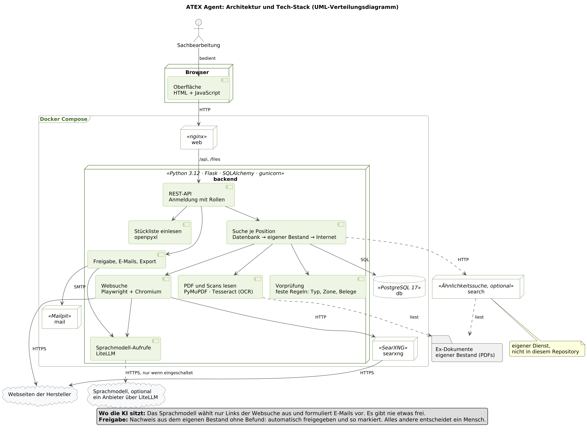

# ATEX Agent

Ein Werkzeug, das zu jedem Ex-Bauteil einer Maschine die Nachweise zum Explosionsschutz sucht,
mit festen Regeln prüft und einem Menschen zur Freigabe vorlegt. Entstanden im Team beim
Hanseatic Hackathon 2026, Case von Greif-Velox.

## Das Problem

Greif-Velox baut Abfüllmaschinen für explosionsgefährdete Bereiche. Zu jeder Maschine gibt es
eine Stückliste mit vielen Positionen, und für jedes Bauteil, das im Ex-Bereich sitzt, will der
Kunde die Dokumente zum Explosionsschutz haben: vor allem die EU-Konformitätserklärung, oft auch
die Baumusterprüfbescheinigung.

Heute stellt jemand in der Sachbearbeitung diese Dokumente von Hand zusammen. Er sucht im
eigenen Archiv, auf den Webseiten der Hersteller und schreibt E-Mails, wenn etwas fehlt. Für jedes
gefundene PDF prüft er, ob der Typ wirklich drinsteht, ob die Kategorie zur Zone passt und ob die
Erklärung noch nach der alten Richtlinie 94/9/EG ausgestellt ist. Am Ende trägt er alles in eine
Excel-Liste für den Kunden ein. Für eine einzige Maschine dauert das Stunden.

## Was wir gebaut haben

- Die Stückliste wird als Excel-Datei hochgeladen. Fehlen Angaben (zum Beispiel die
  Artikelnummer des Herstellers), meldet das die Eingangsprüfung, statt etwas zu ergänzen.
- Je Position sucht der Agent in drei Stufen: in der eigenen Datenbank (schon geprüfte Bauteile),
  im Dokumentenarchiv (eigener Dienst mit Versionen je Bauteil) und zuletzt auf der Webseite des
  Herstellers.
- Jeder Fund geht durch eine Vorprüfung im Code: Typ im Dokument, Kategorie gegen Zone,
  Richtlinie, Ausgabe der Normen. Jede gelesene Angabe steht mit Datei und Seite da, im PDF sind
  die Stellen markiert.
- Ein Nachweis aus dem eigenen Bestand, an dem die Vorprüfung nichts findet, wird automatisch
  freigegeben und als solcher markiert. Alles andere gibt ein Mensch frei oder lehnt es ab.
- Fehlt ein Dokument, liegt ein E-Mail-Entwurf an den Hersteller bereit. Ein Mensch sendet ihn,
  erinnert und eskaliert bei Bedarf an den Einkauf.
- Die Kundenliste als Excel gibt es erst, wenn alles vollständig ist. Vorher gibt es jederzeit
  eine Fehlliste und einen deutlich markierten Zwischenstand.
- Anmeldung mit drei Rollen. Jede Freigabe und jede Änderung trägt den Namen des Kontos.

## Warum es so gebaut ist

Ob ein PDF zu einer Position passt, lässt sich im Text nachsehen: Typbezeichnung, Kennzeichnung,
Kategorie, Richtlinie. Ein Sprachmodell kann dabei überzeugend falsch liegen, und ein falscher
Nachweis in der Dokumentation für den Kunden ist schlimmer als ein fehlender. Daraus folgen die
Regeln, nach denen der ganze Code gebaut ist:

1. **Regeln entscheiden, nicht das Modell.** Was ein Fund ist und ob eine Position vollständig
   ist, rechnet der Code nach festen Regeln aus. Das Ergebnis ist nachvollziehbar und testbar.
2. **Das Modell hilft nur an zwei Stellen.** Es darf aus einer Liste von Links auf der
   Herstellerseite den passendsten wählen (übernommen wird nur eine URL, die wörtlich in der Liste
   stand), und es darf die Einleitung einer Anfrage-E-Mail formulieren (die Fakten setzt der
   Code ein). Beides ist im Standard ausgeschaltet. Ohne Modell gelten feste Regeln und eine feste
   Vorlage.
3. **Jede Angabe hat eine Quelle:** Datei, Seite und meist die Textstelle, dazu je Fund die
   Herkunft (Archiv, Internet-Link, Upload).
4. **Unsicher heißt melden, nicht raten.** Ein Fund ohne klaren Treffer bleibt „unklar“ mit
   Grund, eine fehlende Angabe bleibt „Angabe fehlt“.
5. **Ein Mensch gibt frei.** Der Name kommt aus der Sitzung, nie aus der Anfrage.
6. **Automatisch nur das Saubere.** Selbst freigegeben werden nur Konformitätserklärungen und
   Baumusterprüfbescheinigungen aus dem eigenen Bestand, an denen die Vorprüfung nichts zu
   beanstanden hat. Funde aus dem Internet, Datenblätter und alles mit Befund sieht ein Mensch.
   `AUTOMATISCH_FREIGEBEN=0` schaltet das ganz ab.

## Wie es funktioniert

1. Hochladen: `services/excel_import.py` prüft das Eingangsschema und legt einen Vorgang an.
2. Agent starten: Man wählt die Sprachen, in denen man die Dokumente braucht.
3. Suche je Position: Datenbank, dann Dokumentenarchiv, dann Websuche über SearXNG und einen
   Browser ohne Fenster. Ohne Archiv steht ein Ordner je Hersteller unter `data/ex_dokumente/`
   für das Archiv.
4. Vorprüfung jedes Kandidaten: Typ, Zone, Belege, Angaben, Sprachen. Von mehreren Fassungen
   derselben Erklärung bleibt nur die neueste ein Vorschlag.
5. Freigabe auf der Seite der Position. Sie schreibt in die Stammdaten und legt die Datei als
   neue Version ins Archiv.
6. Ohne Fund: E-Mail-Entwurf, Versand nach Prüfung durch einen Menschen, Erinnerung, Eskalation.
7. Vollständig ist eine Position, wenn die EU-Konformitätserklärung auf Deutsch geprüft vorliegt.
   Dann gibt es die Kundenliste.



Das Bild lässt das Dokumentenarchiv der Übersicht halber weg; die Quelle steht in
[docs/bilder/architektur.puml](docs/bilder/architektur.puml). Die Abläufe mit Sequenzdiagrammen
stehen in [docs/ablauf.md](docs/ablauf.md).

| Dienst | Aufgabe | Technik |
|---|---|---|
| `web` | liefert die Oberfläche aus, reicht `/api/`, `/files/` und `/zert/` weiter, prüft die Anmeldung vor dem Archiv | nginx, HTML und JavaScript ohne Build |
| `backend` | Import, Suche, Vorprüfung, Freigabe, E-Mails, Export, Anmeldung | Python 3.12, Flask, SQLAlchemy, gunicorn |
| `db` | Stammdaten, Vorgänge, Benutzer | PostgreSQL 17 |
| `zertifikatsserver` | Dokumentenarchiv: Dateien mit Versionen je Bauteil, Quellennachweis, eigene Texterkennung | Python 3.12, Flask, Tesseract |
| `zertdb` | Datenbank des Archivs | PostgreSQL 17 |
| `searxng` | Einstieg der Websuche, liefert Trefferlinks | SearXNG |
| `mail` | fängt jede E-Mail ab | Mailpit |
| `ollama` | optionales lokales Sprachmodell, nur mit `--profile ollama` | Ollama |

## Lokal starten

Voraussetzung ist Docker mit Compose und rund 5 GB Platz für die Images. Das Backend allein ist
rund 2,7 GB groß, weil Chromium für die Websuche und Tesseract für gescannte PDFs darin stecken.

```bash
cp .env.example .env      # optional, ohne .env gelten dieselben Standardwerte
docker compose up --build
```

Danach läuft die Oberfläche auf http://localhost:8000 (Port über `WEB_PORT` in `.env`), Mailpit
auf http://localhost:8025. Der Zugang für die lokale Demo steht in `.env.example`
(`ADMIN_BENUTZER`, `ADMIN_PASSWORT`). Das Backend legt das Konto beim ersten Start an und warnt
im Log, solange das Standardpasswort gilt. Für alles außer einem lokalen Test bitte Passwort,
`SECRET_KEY` und den Schlüssel in `searxng/settings.yml` ändern.

Der Stack läuft ohne Sprachmodell. Wer eins nutzen will, trägt es in `config/modelle.yaml` ein
([config/README.md](config/README.md)) und setzt `INTERNET_LLM=1` oder `EMAIL_MIT_LLM=1`.

**Eigene Daten.** Die Dokumente und die Stückliste aus dem Case sind nicht öffentlich und liegen
nicht im Repository. Ohne sie startet alles, die Suche findet nur nichts. Eigene Daten:

- PDFs nach `data/ex_dokumente/<Hersteller>/` legen. Das Archiv liest den Ordner beim ersten
  Start ein, gescannte PDFs liest die Texterkennung im Hintergrund.
- Eine Stückliste als `.xlsx` hochladen. Welche Spalten und Kopfzeilen sie braucht, steht in
  [data/README.md](data/README.md).

Befehle für Logs, Nachholen, Benutzer an der Kommandozeile und Zurücksetzen stehen in
[docs/betrieb.md](docs/betrieb.md).

## Tests

```bash
docker compose build backend zertifikatsserver
P=$(basename "$PWD" | tr '[:upper:]' '[:lower:]')   # Compose benennt die Images nach dem Ordner

# Backend
docker run --rm -e PYTHONDONTWRITEBYTECODE=1 -v "$PWD/backend:/app" \
  "$P-backend" python -m pytest -q -p no:cacheprovider

# Dokumentenarchiv
docker run --rm -e PYTHONDONTWRITEBYTECODE=1 -v "$PWD/zertifikatsserver:/app" \
  "$P-zertifikatsserver" python -m pytest -q -p no:cacheprovider
```

Heißt das Image anders, zeigt `docker images` den Namen. Beide Suiten laufen gegen SQLite und
brauchen keinen laufenden Stack; Sprachmodell, Archiv, Webseiten und Postfach sind durch Attrappen ersetzt. Ohne die PDFs
aus dem Case überspringt das Backend die vier Tests, die echte Dokumente oder eine Beispieldatei
brauchen. Stand dieser Fassung: Backend 583 bestanden, 4 übersprungen; Archiv 73 bestanden.

Nicht durch Tests abgedeckt sind die Oberfläche (von Hand im Browser geprüft), nginx und echte
Aufrufe von Sprachmodellen, Herstellerseiten und Postfächern.

## Grenzen und was nicht fertig ist

- **Ähnlichkeitssuche:** Das Backend kann einen Suchdienst als zusätzliche Stufe fragen
  (`services/rag.py`, `SEARCH_URL`). Der Dienst selbst gehört nicht zu diesem Repository, weil er
  auf Code aus dem Case aufbaute. Ohne ihn ist die Stufe aus.
- **Kein echtes Postfach:** Alle E-Mails landen in Mailpit. Ein echtes Postfach lässt sich über
  `SMTP_*` einstellen, ausprobiert ist das nicht. `EMAIL_NUR_TEST=1` leitet auch dann jede E-Mail
  an die Testadresse um.
- **Nichts ist deployt.** Das Projekt lief nur lokal mit Docker Compose.
- **Die Regeln hat das Team festgelegt.** Welche Dokumente Pflicht sind, wann ein Bauteil als
  Ex-Teil gilt und wie die Vorprüfung urteilt, hat der Case-Geber nicht bestätigt.
- **Websuche:** Sie kennt nur fünf Herstellerseiten (Festo, Pepperl+Fuchs, Siemens, Rittal,
  R. STAHL) und hat in unseren Testläufen kaum brauchbare Funde geliefert.
- **Lesemuster** für Normen, Richtlinien, Datum und Kennzeichnung sind nur an den Dokumenten des
  Case ausprobiert. Andere Hersteller schreiben anders.
- **Trefferquote:** nicht gemessen, weil es keine Liste mit erwarteten Ergebnissen gab.
- **Betrieb:** ein gunicorn-Prozess, der Suchlauf liegt im Arbeitsspeicher (nach einem Neustart
  setzt das Backend offene Läufe fort). Kein Schema-Werkzeug, neue Spalten ergänzt der Start.
- **Ausgeblendete Seiten:** EX-Bauteil-Liste, Fragen, Dokumentenarchiv, Sprachmodelle und
  Sprachversionen sind in der Oberfläche ausgeblendet, der Code ist noch da (Liste
  `AUSGEBLENDET` in `web/index.html`).

## Stack

| Bereich | Technik |
|---|---|
| Backend und Archiv | Python 3.12, Flask 3.1, Flask-SQLAlchemy, gunicorn |
| Datenbanken | PostgreSQL 17 (zwei getrennte), SQLite in den Tests |
| PDF und Scans | PyMuPDF, Tesseract (Deutsch, Englisch, Französisch) |
| Excel | openpyxl |
| Websuche | SearXNG, Playwright mit Chromium, httpx, html2markdown |
| Sprachmodelle (optional) | LiteLLM, ein Aufruf für alle Anbieter |
| E-Mail | `smtplib`, Mailpit als Test-Postfach |
| Oberfläche | eine `index.html` mit Modulen in `web/seiten/`, ohne Build, nginx |
| Tests | pytest |
| Betrieb | Docker Compose |

## Weitere Doku

| Datei | Inhalt |
|---|---|
| [docs/architektur.md](docs/architektur.md) | Dienste, Anmeldung, Archiv, Sprachmodelle und warum |
| [docs/ablauf.md](docs/ablauf.md) | die Abläufe im Detail, Stand einer Position |
| [docs/datenmodell.md](docs/datenmodell.md) | Tabellen des Backends |
| [docs/api.md](docs/api.md) | alle Endpunkte des Backends |
| [docs/betrieb.md](docs/betrieb.md) | Befehle und alle Einstellungen |
| [backend/README.md](backend/README.md), [zertifikatsserver/README.md](zertifikatsserver/README.md), [web/README.md](web/README.md), [config/README.md](config/README.md), [data/README.md](data/README.md) | je Teil |
