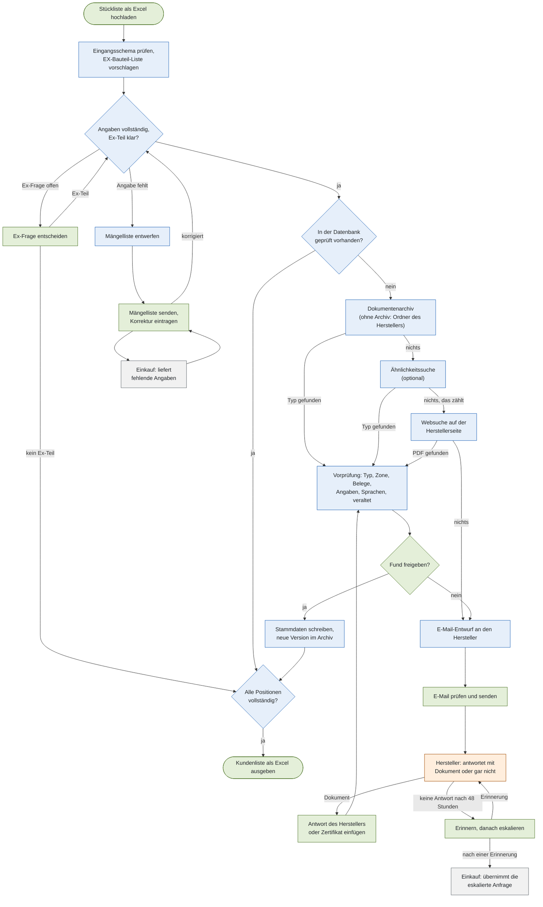
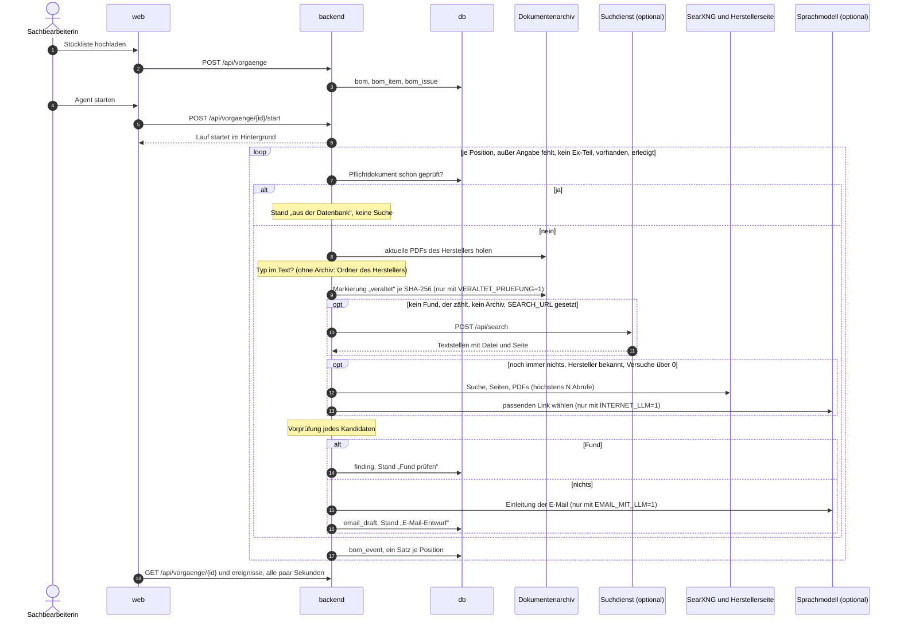
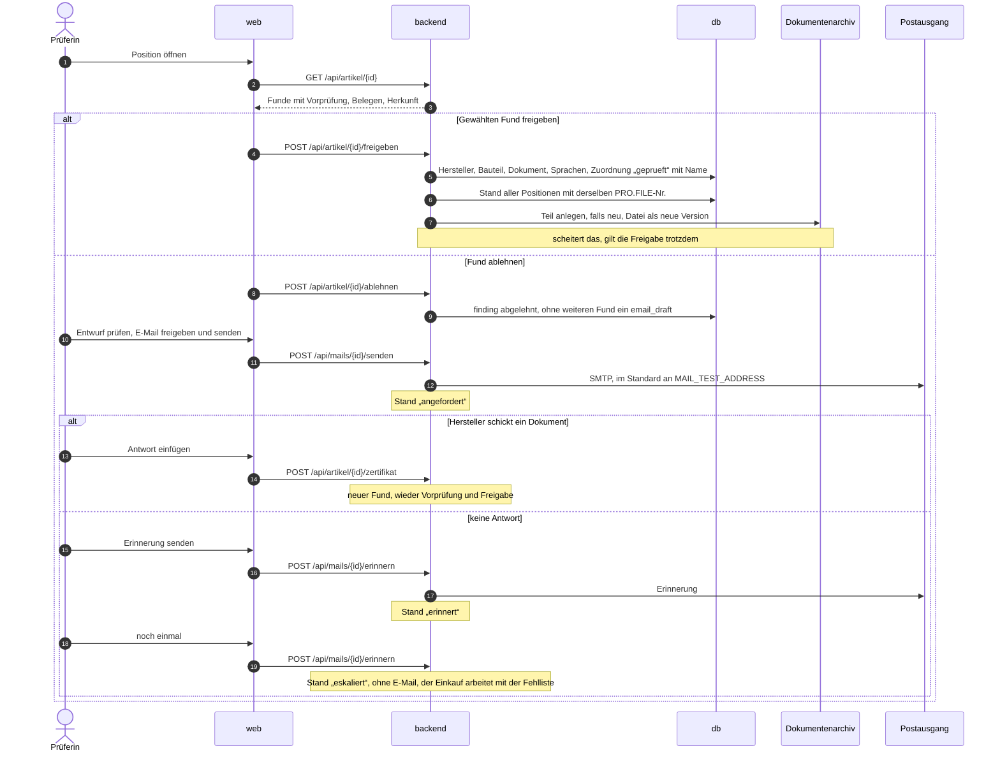
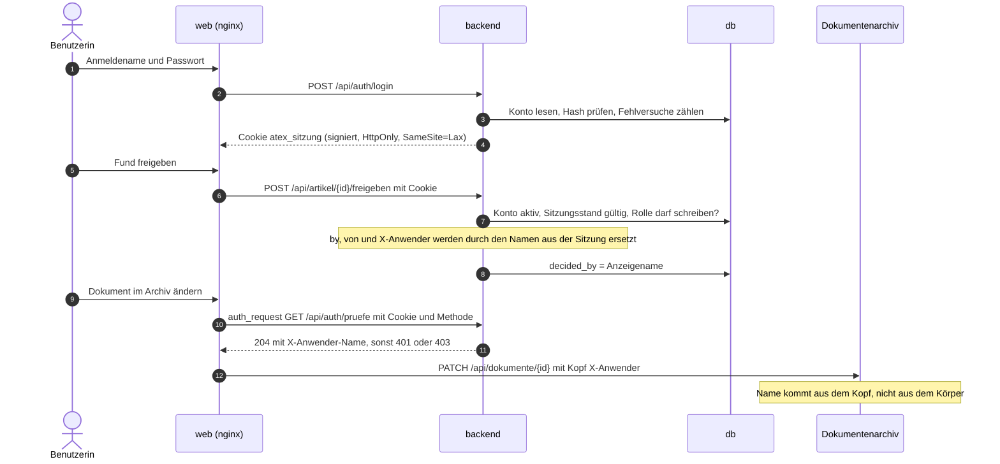
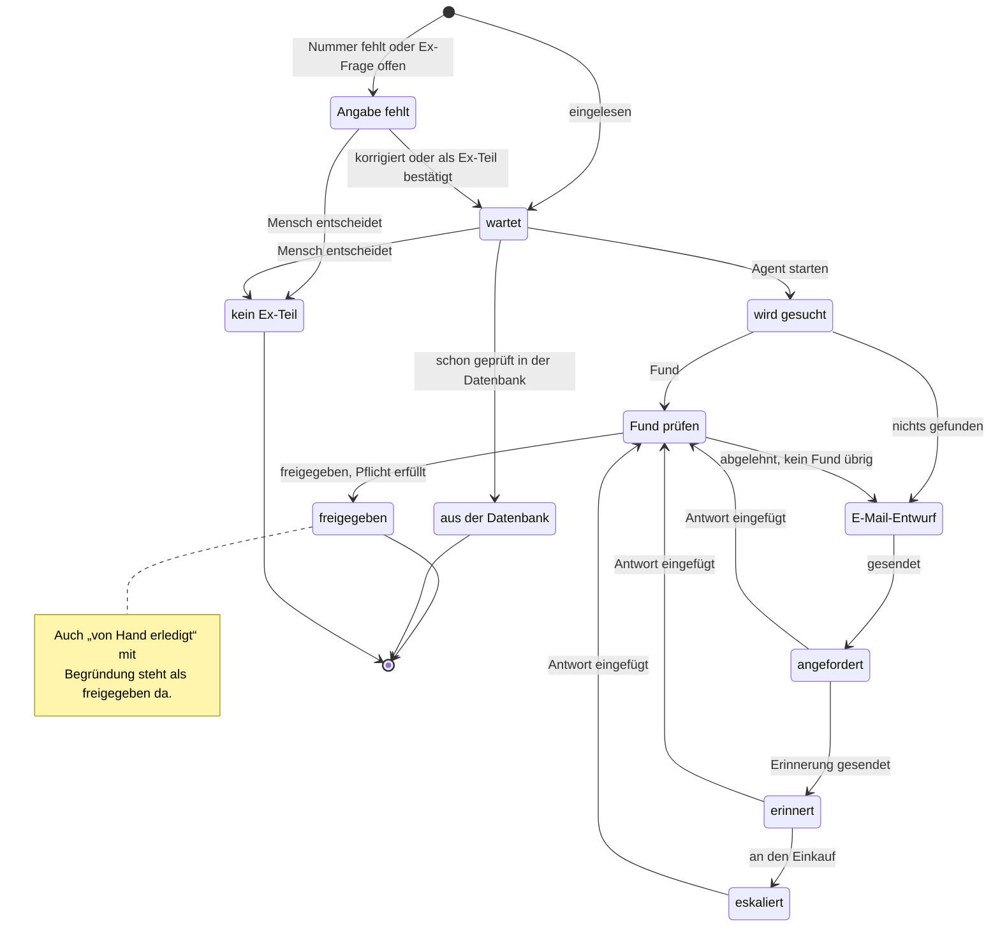

# Abläufe im Detail

Erst die Bilder: der Fachprozess mit seinen Bahnen und die drei Abläufe, die das Ganze tragen.
Danach steht, was die Bilder weglassen: welche Datei was tut, welche Tabelle sich ändert, was bei
Fehlern passiert. Die Oberfläche spricht den Vertrag des Oberflächen-Entwurfs aus dem Team (`/api/vorgaenge`, `/api/artikel`,
`/api/mails`, umgesetzt in `backend/app/routes/oberflaeche.py` und
`services/oberflaeche.py`); dieselben Schritte gibt es auch als „klassische“ API unter
`/api/boms/…` ([api.md](api.md)).

## Prozess

Die Farben sind die Bahnen: **grün = Mensch** (Sachbearbeitung, Prüfung und Freigabe),
**blau = Agent** (Code; ein Sprachmodell nur als Vorschlag), **orange = Hersteller**,
**grau = Einkauf**. Die Ex-Frage und die Mängelliste stehen im Bild, sind in der Oberfläche aber
im Standard ausgeblendet (`EX_LISTE`).

## Die drei Abläufe als Sequenz

**(a) Hochladen und Suche je Position**

**(b) Prüfen, freigeben oder nachfordern**

**(c) Anmeldung, und wie der Name jede Änderung erreicht**

**Stand einer Position**, so wie die Oberfläche ihn nennt (Ableitung in
`backend/app/services/status.py`, Übersetzung in `services/oberflaeche.py`):

## (a) Hochladen und Suche je Position

**Hochladen** (`POST /api/vorgaenge`, Feld `datei`, optional `name`):
`services/excel_import.py` liest die Kopfzeilen (Maschine, Ex-Bereich, geforderte Kategorie)
und die Positionen. Ohne Kopfzeile, ohne Pflichtspalte oder ohne Positionen wird die Datei ganz
abgelehnt und nichts gespeichert. Sonst entstehen `bom`, je Zeile ein `bom_item` und je
Auffälligkeit ein `bom_issue` (Codes in [../backend/README.md](../backend/README.md)). Der Name
des Vorgangs wird eindeutig gemacht („ (2)“ bei Gleichstand).

**EX-Bauteil-Liste:** `services/ex_liste.py` ordnet jede Position nach Einbauort und
Ex-Hinweisen ein und rechnet das bei jedem Abruf neu. Ist die Regel unsicher, steht die Position
auf `klaerung` (Oberfläche: „Angabe fehlt“) und wird nicht gesucht, bis ein Mensch sie als
Ex-Teil bestätigt oder „kein Ex-Teil“ entscheidet.

**Lauf** (`POST /api/vorgaenge/<id>/start`): Der Lauf läuft in einem Hintergrund-Thread des
einen gunicorn-Prozesses; `409`, solange schon einer läuft. `bom.search_started_at` markiert
den offenen Lauf. Startet das Backend mitten im Lauf neu, setzt die erste Anfrage danach ihn für
die noch nicht gesuchten Positionen fort (Eintrag im Protokoll). Am Anfang setzt
`modelle.fuer_lauf(bom)` das Sprachmodell und die Zahl der Web-Abrufe dieses Vorgangs.

Je Position (`services/suche.py`, Reihenfolge im Kopf der Datei):

1. **Datenbank:** `status.aktualisiere` erkennt, ob die EU-Konformitätserklärung für diese
   PRO.FILE-Nr. geprüft und in der Pflichtsprache vorliegt. Dann `vorhanden`, keine Suche.
   Übersprungen werden auch `klaerung`, `kein_ex_teil` und `erledigt`.
2. **Dokumentenarchiv:** Mit `ZERTIFIKATSSERVER_URL` liefert `ordner_fuer` nur einen
   Zwischenspeicher mit allen aktuellen PDFs des Herstellers im Archiv
   (`zertifikatsserver.auszug`, unter `_upload/zertifikatsserver/<Hersteller>/`; Dateien, die
   schon unter `ATEX_DOCS` liegen, werden kopiert statt geladen). Der Herstellerordner wird dann
   nicht durchsucht, und die Ähnlichkeitssuche fällt weg: nach dem Archiv kommt gleich das
   Internet. Antwortet das Archiv nicht, sucht der Agent nur in der Datenbank und im Internet.
   Ohne Archiv steht der Herstellerordner unter `ATEX_DOCS` für das Archiv (Entwicklung, Tests).
   Gesucht wird die Typbezeichnung im PDF-Text und im Dateinamen. Für jeden Treffer fragt
   `zertifikatsserver.pruefe` das Archiv über den SHA-256 nach einer Markierung „veraltet“:
   ein Verdacht steht in der Vorprüfung. Ein Nachweis (Konformitätserklärung,
   Baumusterprüfbescheinigung) mit Vorprüfung „ok“ ist danach automatisch freigegeben
   (`freigabe.automatisch`, Schalter `AUTOMATISCH_FREIGEBEN`).
3. **Ähnlichkeitssuche** (optional, nur mit `SEARCH_URL` und ohne Archiv, nur wenn Schritt 2
   nichts hat, das zählt; der Suchdienst gehört nicht zu diesem Repository):
   `services/rag.py` fragt den Dienst mit Hersteller, Typ und Bezeichnung. Die Treffer
   sind nur Kandidaten; jede Datei geht durch dieselbe Prüfung wie in Schritt 2. Ohne
   Typ-Treffer höchstens zwei Vorschläge, immer „unklar“, nur aus den Ordnern der Position.
   Baut der Dienst noch oder antwortet nicht, geht es weiter.
4. **Websuche** (nur wenn bis hier nichts zählt, nur für die fünf Hersteller in
   `internet.HERSTELLER`, höchstens `INTERNET_VERSUCHE_PRO_TEIL` Abrufe): Einstieg über SearXNG
   mit `site:<domain> <Typ> ATEX`, Seiten über Headless-Chromium, jede Seite nur als Markdown
   ausgewertet. Mit `INTERNET_LLM=1` wählt das Sprachmodell aus höchstens 15 Links; übernommen
   wird nur eine URL, die wörtlich in der Liste stand. PDFs landen in `ATEX_DOCS/_internet/` und
   gehen durch dieselbe Prüfung. robots.txt wird beachtet; sperrt ein Host, wird er im Lauf nicht
   mehr gefragt. Links, die das Sprachmodell nicht wählt, bleiben als Reserve: Bringt seine
   Auswahl keinen Fund, geht die Suche dort weiter (`internet.RESERVE`). Ein Datenblatt ist kein
   Fund, auch wenn es den Typ nennt (`suche.dokumentart`: Dateiname oder Kopf sagt Datenblatt;
   die Mehrzahl „Konformitätserklärungen“ in einer Zulassungsliste zählt nicht als Erklärung).
   Ein Typmuster mit kurzem Anfang wie „NJ…-N“ trifft Bezeichnungen, die so beginnen und den
   Schluss als eigenes Glied haben („NJ0,8-5GM-N“, `pruefung._muster_mit_schluss`).
5. **Sprachversionen:** Fehlt einem Fund die Pflichtsprache, sucht ein zweiter Durchgang im
   Herstellerordner die anderen Sprachfassungen (`services/sprachversionen.py`).
6. **Sprachen des Vorgangs:** Wer den Agenten startet, wählt die Sprachen (`Bom.sprachen`). Funde,
   die nur in anderen Sprachen vorliegen, werden nicht vorgeschlagen (`suche._nur_gewaehlte`);
   Funde ohne erkennbare Sprache (Scans) bleiben. Ist die Pflichtsprache nicht gewählt, gilt die
   erste gewählte.
7. **Ältere Fassungen:** Hat die Position mehrere Konformitätserklärungen, fällt jede weg, zu
   der eine neuere vorliegt (`suche.aeltere_fassungen`): gleicher Typ im Dokument und späteres
   Datum, oder nur 94/9/EG neben einer Erklärung nach 2014/34/EU; jeweils nur, wenn die neuere
   alle Sprachen der älteren enthält. Das Datum ist das Ausstellungsdatum, sonst der Stand aus
   dem Seitenkopf (`angaben.kopfdatum`). „Gesucht in“ nennt, wie viele weggelassen wurden.
8. **Automatische Freigabe:** siehe Schritt 2.

**Vorprüfung** jedes Kandidaten: `services/pruefung.py` (Typ genau im Text? Kategorie gegen
Zone? Ergebnis `ok`, `warnung` oder `unklar` mit Grund), `services/belege.py` (Typ,
Kennzeichnung, Zertifikatsnummer, Kategorie je mit Seite, Tabelle, Zeile oder „unbelegt“),
`services/angaben.py` (Gültigkeit, Ausstellung, Richtlinien, Normen, benannte Stelle … je mit
Seite; nur Regeln, kein Sprachmodell). Das Ergebnis wird ein `finding` mit Status
`vorgeschlagen`.

**Ende je Position:** Gibt es einen Vorschlag, steht sie auf `vorschlag` („Fund prüfen“). Sonst
`nicht_gefunden`, und `email_entwurf.lege_entwuerfe_an` legt einen Entwurf an; mit
`EMAIL_MIT_LLM=1` schreibt das Sprachmodell Anrede und Einleitung aus Hersteller, Typ,
Bezeichnung und Einbauort, die Fakten setzt der Code ein, ein unbrauchbarer Text fällt auf die
feste Vorlage zurück. `searched_in` sagt in ganzen Sätzen, wo gesucht wurde; `bom_event` hält
eine Zeile je Position fest.

**Fehler:** Scheitert eine Position, steht das im Protokoll, und der Lauf geht weiter. Fehlt der
Ordner `ATEX_DOCS` ganz, startet der Lauf nicht (`503`). Archiv, Suchdienst oder Sprachmodell
nicht erreichbar: Der Lauf arbeitet ohne diese Stufe weiter und sagt es in „gesucht in“.

## (b) Prüfen, freigeben oder nachfordern

**Ansehen:** `GET /api/artikel/<id>` liefert die Funde mit Vorprüfung, Belegen, Angaben und
Herkunft (`quellennachweis`). Das PDF kommt über `/files/<pfad>?markiert=<fund>`, mit gelb
markierter Fundstelle, grün belegten und orange unbelegten Angaben.

**Freigeben** (`POST /api/artikel/<id>/freigeben`, `fund_id`, optional `doc_type`):
`freigabe.entscheide` legt Hersteller, Bauteil, Dokument, Sprachen und die Zuordnung
`part_document` mit Status `geprueft`, Name und Zeit an; aus den Angaben geht nur
`gueltig_bis` nach `document.valid_until`. Danach leitet es den Stand aller Positionen mit
derselben PRO.FILE-Nr. neu ab, auch in anderen Vorgängen. `zertifikatsserver.nach_freigabe`
lädt die Datei als neue Version ins Archiv (`quelle=atex_agent`, Quellennachweis in
`quelle_*`), wenn das Archiv sie noch nicht kennt. Scheitert das, gilt die Freigabe trotzdem;
das Protokoll sagt es, nachgeholt wird mit `flask --app wsgi zert-abgleich` oder bei der nächsten
Freigabe. Ist danach immer noch kein Pflichtdokument da (z. B. nur eine Anleitung freigegeben),
entsteht ein E-Mail-Entwurf.

**Ablehnen** (`POST /api/artikel/<id>/ablehnen`, `grund`, optional `fund_id`): Der Fund wird
`abgelehnt` und bei der nächsten Suche nicht wieder vorgeschlagen. Bleibt kein Vorschlag übrig,
entsteht der Entwurf; der Grund steht darin als Zeile „Grund der Anfrage: …“. Ist schon eine
Anfrage gesendet, bleibt die Position `angefordert`.

**Senden** (`PUT /api/mails/<id>` zum Ändern, `POST /api/mails/<id>/senden`): Senden ist
Freigabe und Versand in einem Klick. Der Empfänger kommt aus den Herstellerkontakten
(`hersteller_kontakt`); ohne Adresse `409`. Mit `EMAIL_NUR_TEST=1` (Standard) geht die E-Mail an
`MAIL_TEST_ADDRESS`, der Entwurf nennt die Adresse des Herstellers nur. `services/versand.py`
schickt über SMTP; Fehler werden ein Satz für die Oberfläche, der Grund steht im Log.

**Antwort des Herstellers** (`POST /api/artikel/<id>/zertifikat`, Herkunft `hersteller`): Das PDF
wird ein Vorschlag mit Vorprüfung, wie ein Fund. Mit Herkunft `manuell` und einer Dokumentart ist
es sofort freigegeben (Zertifikat von Hand einfügen, M18).

**Erinnern und eskalieren** (`POST /api/mails/<id>/erinnern`): `services/erinnerung.py` sagt, was
fällig ist. Der erste Druck legt eine Erinnerung an und sendet sie, nach `ERINNERUNGEN_MAX`
Erinnerungen (Standard 1) eskaliert der nächste Druck an den Einkauf: Die Position steht dann auf
`eskaliert`, eine E-Mail geht dabei nicht hinaus, der Einkauf arbeitet mit der Fehlliste. Die
Frist `ERINNERUNG_NACH_STUNDEN` (48) übergeht der Knopf im Standard
(`OBERFLAECHE_DEMO_48H=1`, für die Demo); mit `0` antwortet er vor Ablauf mit `409`.

**Von Hand erledigen:** Ein Mensch kann eine Position mit Begründung erledigen
(`POST /api/boms/<id>/items/<item_id>/resolve`); sie hält die Ausgabe dann nicht mehr auf und
bleibt in Kunden- und Fehlliste sichtbar.

**Ausgabe:** `GET /api/vorgaenge/<id>/export` gibt die Kundenliste erst, wenn jede Position auf
`vorhanden`, `kein_ex_teil` oder `erledigt` steht (sonst `409`); `?zwischenstand=1` jederzeit,
deutlich als Zwischenstand markiert. Die Fehlliste: `GET /api/boms/<id>/missing.xlsx`.

## (c) Anmeldung und der Name bei jeder Änderung

- **Anmelden** (`POST /api/auth/login`): Konto in `benutzer`, Passwort-Hash scrypt. Falsches
  Passwort, unbekanntes oder deaktiviertes Konto geben denselben Text (`401`); jeder Fehlversuch
  wartet 0,5 s; nach 5 Fehlversuchen ist das Konto 15 Minuten gesperrt (`429`).
- **Sitzung:** signiertes Cookie `atex_sitzung` (HttpOnly, SameSite=Lax, 8 Stunden ab der
  Anmeldung). Im Cookie und am Konto steht `sitzungs_stand`; ein neues Passwort oder eine
  Deaktivierung erhöht ihn, ältere Cookies gelten dann nicht mehr. Das Backend lädt das Konto
  bei jeder Anfrage.
- **Prüfung an einer Stelle:** `before_request` in `backend/app/auth.py`. Ohne Sitzung `401`
  (außer `/health`, Anmelden, Abmelden), Rolle `leser` bei allem außer `GET`, `HEAD`, `OPTIONS`
  `403`.
- **Der Name:** Die Request-Klasse `AnfrageMitAnwender` ersetzt bei schreibenden Anfragen `by`
  und `von` in JSON und Formular sowie den Kopf `X-Anwender` durch den Anzeigenamen aus der
  Sitzung. So schreibt jede Route den richtigen Namen, auch eine, die später dazukommt.
- **Archiv:** nginx fragt vor jedem `/zert/` per `auth_request` `GET /api/auth/pruefe` (mit
  Cookie und der Methode im Kopf `X-Original-Method`). `204` bringt den Namen im Kopf
  `X-Anwender-Name`; nginx reicht ihn URL-kodiert als `X-Anwender` weiter und überschreibt einen
  gleichnamigen Kopf des Browsers. Das Archiv nimmt den Namen aus diesem Kopf, nicht aus `von`.
  Sein Port 5100 ist deshalb nur an `127.0.0.1` gebunden. Ruft das Backend das Archiv selbst
  (Freigabe), schickt es den Namen des Freigebenden als `von`.
- **Oberfläche:** Bei `401`, auch aus den Modulen, zeigt die Seite die Anmeldung und kehrt
  danach auf dieselbe Seite zurück. Für Leser blendet sie Formulare zum Ändern aus.

## Stand einer Position

`bom_item.status` setzt nur `services/status.py`; die Oberfläche übersetzt ihn
(`services/oberflaeche.py`, `STATUS`):

| Gespeichert | Oberfläche | Bedeutung |
|---|---|---|
| `offen` | wartet | noch nicht gesucht |
| – | wird gesucht | der Lauf bearbeitet gerade diese Position (nur im Arbeitsspeicher) |
| `klaerung` | Angabe fehlt | PRO.FILE-Nr. oder Hersteller-Artikelnr. fehlt, oder die Ex-Frage ist offen |
| `vorschlag` | Fund prüfen | mindestens ein Vorschlag wartet auf einen Menschen |
| `vorhanden` | aus der Datenbank / freigegeben | Pflichtdokument geprüft vorhanden; „freigegeben“, wenn es in diesem Vorgang freigegeben wurde |
| `nicht_gefunden` | E-Mail-Entwurf | gesucht, nichts gefunden |
| `angefordert` | angefordert / erinnert | Anfrage gesendet; „erinnert“, sobald eine Erinnerung gesendet ist |
| `eskaliert` | eskaliert | an den Einkauf eskaliert, bleibt offen |
| `erledigt` | freigegeben | von Hand erledigt, Begründung in der Notiz |
| `kein_ex_teil` | kein Ex-Teil | Entscheidung eines Menschen |

Ein Vorschlag geht vor: Kommt zu einer angefragten oder eskalierten Position eine Antwort
herein, steht sie wieder auf „Fund prüfen“.
