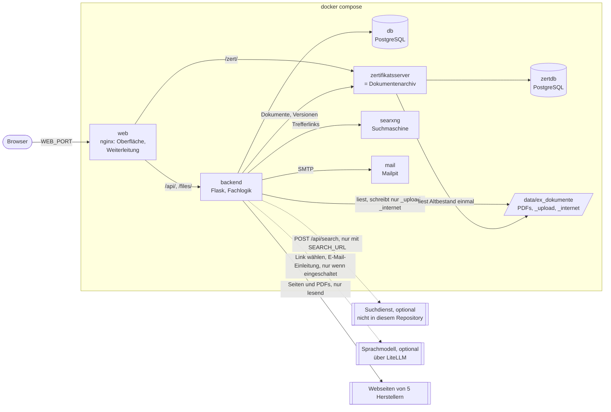
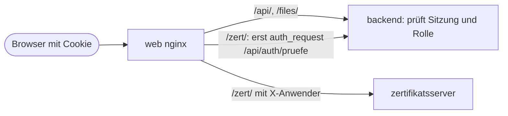
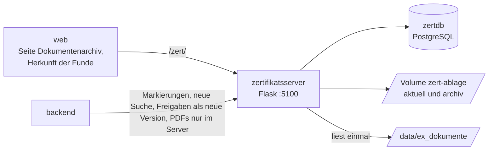
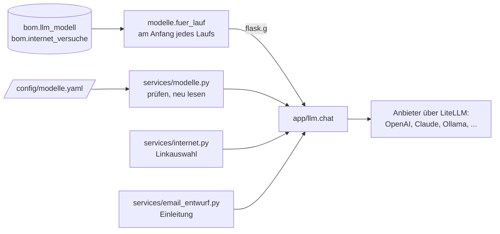

# Architektur

## Dienste

Das Bild der Dienste steht im [README](../README.md#wie-es-funktioniert), die Abläufe in
[ablauf.md](ablauf.md).

| Dienst | Port auf dem Rechner | Daten |
|---|---|---|
| `web` | `WEB_PORT` (8000), von außen erreichbar | keine; `web/` als Bind-Mount |
| `backend` | 127.0.0.1:5000 | `db`; `data/ex_dokumente` nur lesend außer `_upload/`, `_internet/`; Volume `ocr-cache` |
| `db` | 127.0.0.1:5433 | Volume `db-data` |
| `zertifikatsserver` | 127.0.0.1:5100 | `zertdb`, Volume `zert-ablage`; Altbestand nur lesend |
| `zertdb` | 127.0.0.1:5434 | Volume `zert-db-data` |
| `searxng` | 127.0.0.1:8080 | Einstellungen in `searxng/` |
| `mail` | 127.0.0.1:8025 (Web), 127.0.0.1:1025 (SMTP) | ohne Volume |

Nur `web` ist von anderen Rechnern erreichbar, und dort steht die Anmeldung davor.

- **web** zeigt an und nimmt Eingaben entgegen. Es hält keine Daten.
- **backend** enthält die Fachlogik und ist der einzige Dienst, der in die Datenbank `db`
  schreibt. Es ruft das Dokumentenarchiv, SearXNG, das Postfach und, wenn eingestellt, einen
  Suchdienst und ein Sprachmodell.
- **db** merkt sich Bauteile, Dokumente und Zuordnungen. Ein bekanntes, geprüftes Bauteil kommt
  direkt aus der Datenbank, ohne Suche und ohne KI.
- **searxng** ist der Einstieg der Websuche; **mail** (Mailpit) fängt im Standard jede E-Mail ab.
- **Ähnlichkeitssuche** ist eine optionale Stufe: Das Backend braucht nur „Frage rein, Textstellen
  mit Datei und Seite raus“ (`services/rag.py`, Schnittstelle in
  [api.md](api.md#post-apibomsidsearch)). Der Dienst, den wir im Hackathon dafür nutzten, baute
  auf Code aus dem Case auf und gehört nicht zu diesem Repository. Ohne `SEARCH_URL`, oder wenn
  der Dienst nicht antwortet, sucht das Backend ohne ihn weiter.

## Oberfläche

Die Oberfläche ist der Dienst `web` (Port 8000): eine HTML-Datei des Teams (`web/index.html`) mit
Modulen je Funktion unter `web/seiten/`, ausgeliefert von nginx. nginx reicht `/api/` und `/files/`
an das Backend und `/zert/` an den Zertifikatsserver weiter, die Seite spricht also nur mit ihrer
eigenen Adresse.

- **Warum nginx davor:** gleiche Adresse für Seite und API, kein CORS, keine Backend-Adresse in
  der Seite; lange Wartezeit für die Suche und große Uploads an einer Stelle eingestellt.
- **Warum Module:** je Funktion eine Datei, die sich in Leiste, Vorgangs- und Artikelseite
  einhängt ([../web/seiten/README.md](../web/seiten/README.md)); so arbeiten mehrere Leute
  gleichzeitig an der Oberfläche.

Einzelheiten in [../web/README.md](../web/README.md).

## Anmeldung

- **Konten im Backend** (Tabelle `benutzer`), Passwort nur als Hash (`werkzeug.security`, scrypt).
  Rollen `admin`, `pruefer`, `leser` (C1). Konten werden nie gelöscht, nur deaktiviert, weil ihre
  Namen im Protokoll stehen.
- **Sitzung = signiertes Cookie von Flask** (`HttpOnly`, `SameSite=Lax`, 8 Stunden ab der
  Anmeldung, Schlüssel `SECRET_KEY`). Warum kein Token und kein Sitzungsspeicher: Seite und API
  liegen unter derselben Adresse, ein Cookie reicht, und es braucht keinen weiteren Dienst. Damit
  ein neues Passwort oder eine Deaktivierung sofort wirkt, steht ein Zähler (`sitzungs_stand`) im
  Cookie und am Konto; das Backend lädt das Konto bei jeder Anfrage.
- **Prüfung an einer Stelle:** `before_request` in `app/auth.py` für jede Anfrage außer
  `/health`, Anmelden und Abmelden: ohne Sitzung `401`, Rolle `leser` beim Schreiben `403`.
- **Der Name kommt aus der Sitzung:** Wer freigibt, ablehnt oder korrigiert, steht im Protokoll.
  Statt jede Route umzubauen, ersetzt eine eigene Request-Klasse `by`/`von` in JSON und Formular
  und den Kopf `X-Anwender` durch den Anzeigenamen; so kann niemand unter fremdem Namen zeichnen,
  auch nicht über Routen, die später dazukommen.
- **Zertifikatsserver ohne eigene Anmeldung:** nginx fragt vor jedem `/zert/` das Backend
  (`auth_request` auf `GET /api/auth/pruefe`, mit der Methode im Kopf, damit Leser nur lesen) und
  reicht den Namen URL-kodiert im Kopf `X-Anwender` weiter; der Server nimmt ihn vor `von` im
  Körper. Sein Port 5100 ist deshalb nur an `127.0.0.1` gebunden. Das Backend spricht ihn im
  Docker-Netz direkt an.
- **Oberfläche:** Bei `401` (auch aus den Modulen, `fetch` ist umwickelt) zeigt die Seite die
  Anmeldung und kehrt danach auf dieselbe Seite zurück. Die Helfer `anwender()`, `mitName()`,
  `sperre()`, `nameHinweis()` bleiben für die Module; sie sperren Knöpfe für Leser.

## Ablauf eines Vorgangs

Kurzfassung; Einzelheiten in [ablauf.md](ablauf.md).

1. **Upload:** Excel einlesen, Eingangsschema prüfen, fehlende Angaben melden, Ex-Teile
   vorschlagen.
2. **Suche je Position**, sie endet bei der ersten Stufe mit einem Fund, der zählt: Datenbank,
   dann Dokumentenarchiv, dann Internet. Ohne Archiv steht der Ordner des Herstellers für das
   Archiv, und mit `SEARCH_URL` kommt danach die Ähnlichkeitssuche (nur Kandidaten, jede Datei
   geht durch dieselbe Prüfung wie im Ordner).
3. **Prüfung im Code:** Gehört das Dokument zum Typ? Passt die Kategorie zur Zone? Ist die
   Konformitätserklärung da? Dazu liest `services/angaben.py` mit Regeln weitere Angaben (gültig
   bis, Ausgabe, Richtlinien, Normen, benannte Stelle, Hersteller, Umgebungstemperatur …), jede
   mit Seite und Textstelle. Ein abgelaufenes Zertifikat oder eine Konformitätserklärung nur nach
   94/9/EG wird eine Warnung der Vorprüfung.
4. **Freigabe:** Ein Mensch sieht jeden neuen Fund mit Datei und Seite und bestätigt ihn. Erst dann
   steht die Zuordnung als geprüft in der Datenbank, und die Datei liegt als neue Version im
   Dokumentenarchiv.
5. **Nachforderung:** Für fehlende Dokumente entsteht ein E-Mail-Entwurf. Ein Mensch gibt ihn frei
   und sendet ihn; im Standard landet er im Test-Postfach bzw. an der Testadresse
   (`EMAIL_NUR_TEST`). Erinnerung und Eskalation an den Einkauf löst ebenfalls ein Mensch aus.
6. **Ausgabe:** Excel im festen Schema, erst wenn alles vollständig ist; vorher Fehlliste und
   markierter Zwischenstand.

## Wer entscheidet was

| Aufgabe | Wer |
|---|---|
| Vollständigkeit, Zone gegen Kategorie, Dubletten, Typ im Dokument, Angaben aus dem PDF lesen (`angaben.py`, `belege.py`) | Code, nach festen Regeln |
| Ex-Teil oder nicht | Code schlägt vor, ein Mensch entscheidet die unsicheren Fälle |
| Ähnliche Textstellen finden (optional) | ein eigener Suchdienst, nur Kandidaten für die Prüfung im Code |
| Link auf der Herstellerseite wählen (`INTERNET_LLM`), Einleitung einer E-Mail (`EMAIL_MIT_LLM`) | Sprachmodell, als Vorschlag; ob ein PDF ein Fund ist und welche Fakten in der E-Mail stehen, bestimmt der Code |
| Fund freigeben oder ablehnen, E-Mail senden, erinnern, eskalieren, Daten ändern | Mensch |

Das Sprachmodell schreibt nie in geprüfte Daten. Die Zuordnung `part_document` setzt nur die
Freigabe eines Menschen auf `geprueft`, mit Name und Zeit. Der Wert `ki_geprueft` stammt aus der
Vorgabe des Case-Gebers; kein Code setzt ihn, ein Mensch kann ihn in den Stammdaten von Hand
wählen.

## Entscheidungen

- **API und Oberfläche getrennt:** Die Logik bleibt ohne Oberfläche testbar, und zwei Leute können
  gleichzeitig an API und Oberfläche arbeiten.
- **PostgreSQL:** Die Vorgabe des Case-Gebers ist ein relationales Schema mit Verknüpfungen.
- **Keine Migrationen:** Die Tabellen entstehen aus den Modellen. Für zwei Tage Hackathon reicht das.
  Neue Spalten zieht `init-db` in bestehenden Datenbanken nach, soweit das gefahrlos geht
  (`services/schema.py`, [datenmodell.md](datenmodell.md#neue-spalten-in-bestehenden-datenbanken)).
- **Mailpit als Standard:** Der Case verlangt, dass keine E-Mail echte Hersteller erreicht. Ein
  echtes Postfach lässt sich über `SMTP_*` einstellen; `EMAIL_NUR_TEST=1` leitet dann weiter jede
  E-Mail an Hersteller an die Testadresse um.
- **LiteLLM für das Sprachmodell:** Ein Aufruf für alle Anbieter. Die Modelle (Ollama, Claude,
  OpenAI oder ein anderer OpenAI-kompatibler Anbieter) trägt man in `config/modelle.yaml` ein
  (S2). Im Standard ist keins eingeschaltet. Ausprobiert ist im Hackathon nur ein
  OpenAI-kompatibler Anbieter mit eigener Adresse.
- **Ähnlichkeitssuche als eigener Dienst:** Das Backend kennt nur die Schnittstelle. So bleibt der
  Index mit seinen Abhängigkeiten aus dem Backend heraus, und die Stufe lässt sich weglassen.
- **Ähnlichkeit macht nichts „ok“:** Treffer der Ähnlichkeitssuche sind nur Kandidaten. Steht der
  Typ nicht im Dokument, bleibt der Vorschlag „unklar“ mit Grund und zählt nicht als Fund.

## Zertifikatsserver

Eigener Dienst `zertifikatsserver` (Flask, Port 5100) mit eigener Datenbank `zertdb` und eigener
Ablage der Dateien; für Anwender heißt er „Dokumentenarchiv“. Er übernimmt den Ordner
`data/ex_dokumente` beim ersten Start als Altbestand; die Suche liest weiter den Ordner und dazu
die PDFs, die nur das Archiv hat. Einzelheiten in
[../zertifikatsserver/README.md](../zertifikatsserver/README.md).

- **Altbestand:** Beim ersten Start liest der Server den alten Ordner ein (nur lesend). Jede Datei
  liegt danach einmal in `aktuell/<Hersteller>/`, mit Dokumentart, Richtlinie, Normausgaben,
  Zertifikatsnummern, Datum und Sprachen, je mit Seite.
- **Versionen je Teil:** Teil = Hersteller + Hersteller-Artikelnr. Je Dokumentart gibt es
  Versionen 1, 2, …; eine neue Version löst die alte ab, die alte Datei geht nach `archiv/`, ihr
  Link bleibt. Gelöscht wird nie: Dokumente werden ausgemustert, Versionen beendet, beides lässt
  sich wiederherstellen. Jede Änderung von Hand steht mit Name im Protokoll.
- **Nicht nur Zertifikate:** Neben PDFs nimmt das Archiv Office-Dateien, Bilder, Zeichnungen und
  ZIP-Archive an (Endung und Inhalt geprüft, nichts wird ausgeführt oder entpackt, `dateiformate.py`).
  Aus ihnen liest es nichts, ihre Angaben trägt ein Mensch ein; ausgeliefert werden sie als
  Download. Je Teil sind Versionen aller Dokumentarten nebeneinander aktuell.
- **Quellennachweis:** Jedes Dokument trägt strukturiert, woher es kam (Art, Download-Link,
  Webseite, Abrufzeit, wer, ursprünglicher Dateiname, SHA-256, stabiler Link); korrigierbar mit
  Protokoll (`quellen.py`). Die Prüfseite zeigt dasselbe je Fund (`web/seiten/quellen.js`), die
  Kundenliste trägt die Download-Links in „DL-Link“.
- **Verdacht „veraltet“:** Prüfregeln im Code (94/9/EG, alte Normausgabe, älter als N Jahre,
  abgelaufen, kein Datum) setzen einen Verdacht mit Grund und Seite, jede nur für die
  Dokumentarten, für die sie Sinn ergibt, und nur für PDFs. Die aktuellen Normausgaben sind eine
  Tabelle mit Vorgaben, die ein Mensch bestätigt (`POST /api/normen/bestaetigen`). Scans liest
  eine eigene Texterkennung im Hintergrund (Felder `per_ocr`, `ocr_stand`, `ocr_hinweis`). Ein
  Mensch bestätigt oder verwirft auf der Seite „Dokumentenarchiv“. Bestätigte stehen unter
  `GET /api/neue-suche`.
- **Wörter für Anwender:** Die API behält technische Werte und liefert Texte daneben (`…_text`,
  `GET /api/begriffe`), damit jede Oberfläche dieselben Wörter zeigt.
- **Warum ein eigener Dienst:** Das Archiv ist beim Case-Geber ein eigenes System. Getrennt bleibt
  er austauschbar, und das Backend spricht ihn wie später den echten Server über HTTP an.

- **Eine Ablage für PDFs** (`backend/app/services/zertifikatsserver.py`, Einzelheiten in
  [api.md](api.md#zertifikatsserver-in-der-suche)): Gibt ein Mensch im Backend ein Dokument frei,
  das der Server nicht kennt (SHA-256), lädt das Backend es dort als neue Version des Teils hoch,
  mit Quellennachweis in eigenen Feldern;
  scheitert das, gilt die Freigabe trotzdem, das Protokoll des Vorgangs sagt es, nachgeholt wird
  mit `flask --app wsgi zert-abgleich` oder bei der nächsten Freigabe. Umgekehrt holt
  `zertifikatsserver.ordner` die aktuellen PDFs, die nur der Server hat, in einen
  Zwischenspeicher unter `ATEX_DOCS/_upload/zertifikatsserver/<Hersteller>/`, den die
  Ordnersuche wie einen Herstellerordner durchsucht.

## Sprachmodelle

Alle Modelle stehen in einer Datei, `config/modelle.yaml` (nicht im Git, Vorlage im Git), die
das Backend schreibgeschützt unter `/config` liest; ein eigener Suchdienst kann dieselbe Datei
lesen. `services/modelle.py` prüft sie
streng und liest sie bei jeder Änderung neu; `app/llm` ruft das gewählte Modell über LiteLLM auf.

- **Warum eine Datei statt Umgebungsvariablen:** mehrere Modelle mit eigenem Zugang, ohne
  Neustart erweiterbar, eine Quelle für Backend und Suchdienst. Die `LLM_*` bleiben als
  Rückfall ohne Datei.
- **Warum streng:** Ein Tippfehler darf nicht still ein anderes (z. B. teureres oder externes)
  Modell wählen. Fehler führen zu „kein Modell“ mit deutscher Meldung; die Aufrufer arbeiten dann
  wie ohne Schalter nach festen Regeln.
- **Warum über `flask.g`:** Die Wahl je Vorgang erreicht `services/internet.py`, ohne die Datei
  zu ändern; der Hintergrundlauf hat seinen eigenen App-Kontext, also keine Vermischung zwischen
  Vorgängen. E-Mail-Entwürfe laufen in eigenen Threads und setzen das Modell dort selbst.
- **Schlüssel** bleiben auf dem Server: Die Oberfläche zeigt nur „Zugang hinterlegt ja/nein“,
  Fehlertexte werden bereinigt, das Protokoll nennt nur Modellnamen.

## Suchfeld und Postausgang

- Das Suchfeld oben sucht über `GET /api/suche` in Vorgängen, Positionen, Stammdaten,
  Herstellern und im Dokumentenarchiv ([api.md](api.md#suche-über-die-ganze-anwendung)) und
  filtert wie bisher die sichtbare Liste. Pfeiltasten, Enter, Esc; „/“ oder Strg+K springen ins
  Feld.
- Jede E-Mail geht über `services/versand.py`. Das Postfach (Host, Port, Anmeldung, TLS,
  Absender) kommt aus der Umgebung (`.env`, [api.md](api.md#postausgang-servicesversandpy));
  Standard ist Mailpit. `EMAIL_NUR_TEST=1` leitet jede E-Mail an Hersteller und Einkauf an
  `MAIL_TEST_ADDRESS` um. Die E-Mail-Seite sagt in einem Satz, wohin E-Mails in dieser Umgebung
  gehen (`GET /api/mail/einstellungen`).

## Ansichten lesen nur

- Übersicht, Vorgang, Artikel, E-Mails, EX-Bauteil-Liste, Sprachen und Korrektur zeigen den Stand
  jeder Position frisch abgeleitet (`status.aktualisiere`), weil eine Freigabe oder eine Änderung
  der Stammdaten den Stand in allen Vorgängen mit derselben PRO.FILE-Nr. ändert. Sie speichern
  ihn aber nicht: `services/lesepuffer.py` rechnet im Speicher (`no_autoflush`, am Ende
  `rollback`) und lädt alles Nötige je Anfrage in einem Zug (feste Zahl von SQL-Anfragen, siehe
  `tests/test_anfragen_zahl.py`).
- **Warum kein gespeicherter Stand je Vorgang:** Frisch ableiten kostet bei 270 Positionen rund
  50 ms Rechenzeit. Ein gespeicherter Zwischenstand müsste bei jeder Freigabe, Stammdaten-,
  Kontakt- und Fundänderung in allen betroffenen Vorgängen ungültig werden, und ein vergessener
  Weg zeigte still einen falschen Stand. Das lohnt erst bei sehr vielen Vorgängen.
- **Gespeichert** wird der Stand von den schreibenden Wegen. Dafür leitet die Freigabe ihn jetzt
  für alle Positionen mit derselben PRO.FILE-Nr. neu ab, auch in anderen Vorgängen (vorher tat
  das erst der nächste Abruf der Übersicht).

## Fachliche Entscheidungen des Teams

Wo der Case offenließ, wie etwas zu entscheiden ist, hat das Team eine Regel festgelegt. Keine
davon hat der Case-Geber bestätigt; ändert sich eine, ändert sich der Code an genau einer Stelle.

- **Pflichtdokument** ist die EU-Konformitätserklärung in deutscher Sprache (`PFLICHTSPRACHE`).
  Baumusterprüfbescheinigung und Betriebsanleitung werden gesucht und gezeigt, halten aber nichts
  auf (`services/status.py`, `PFLICHT`).
- **Ex-Teil oder nicht** richtet sich nach dem Einbauort (Zone oder ein Bereich aus der Kopfangabe
  „Ex-Bereich“) und nach Ex-Hinweisen in Bezeichnung oder Typ. Zugehöriges Betriebsmittel
  außerhalb des Ex-Bereichs (Kennzeichnung in Klammern, Trennbausteine) gilt als Ex-Teil, weil
  seine Stromkreise in den Ex-Bereich führen (`services/ex_liste.py`). Die Seite dazu ist im
  Standard ausgeblendet (`EX_LISTE`), dann wird jede Position mit Artikelnummer gesucht.
- **Typ und Zone:** Ein Fund zählt nur, wenn der Typ im Dokument steht und die Kategorie zur Zone
  passt (`services/pruefung.py`).
- **Ausgabe:** Die Kundenliste bleibt gesperrt, bis alles vollständig ist. Für eine Weitergabe mit
  Lücken gibt es die Fehlliste und einen deutlich markierten Zwischenstand.
- **Erinnerungen:** eine Erinnerung nach 48 Stunden, danach die Eskalation an den Einkauf
  (`ERINNERUNG_NACH_STUNDEN`, `ERINNERUNGEN_MAX`).

Kürzel wie M8, S2, C1 oder E5 in Code und Doku sind Nummern aus der Anforderungsliste des Teams
(MoSCoW: Must, Should, Could, dazu E für Ergänzungen aus dem Prozessbild). Die Liste selbst ist
nicht Teil dieses Repositorys.
