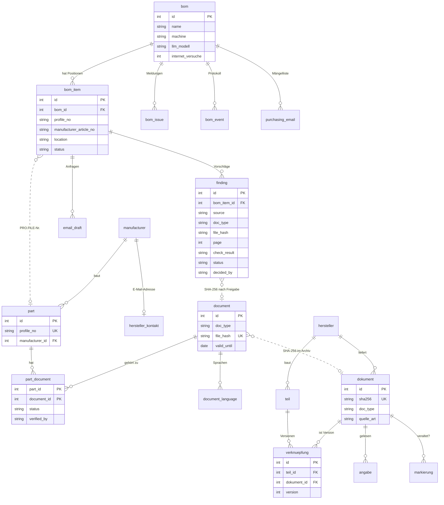
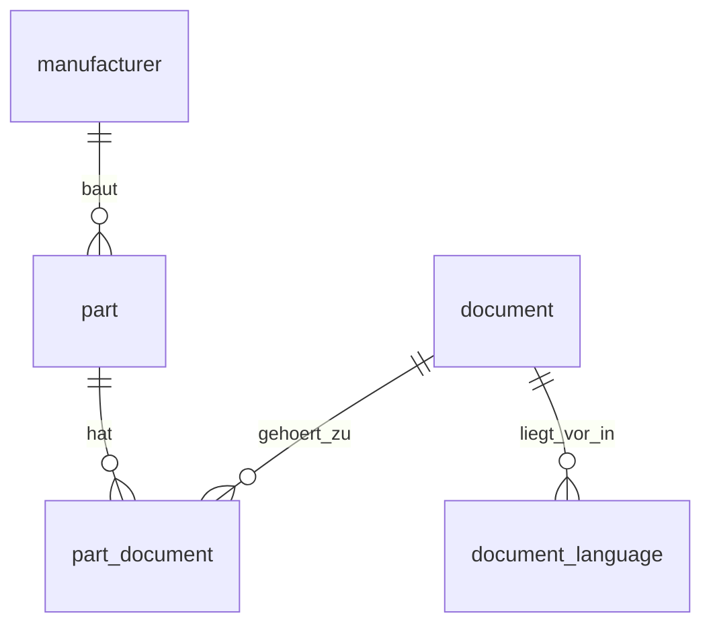

# Datenmodell

Die Tabellen des Backends (Datenbank `db`) entstehen aus `backend/app/models/` und
`backend/app/services/bearbeiten.py` (`finding_correction`): 19 Tabellen. Das Dokumentenarchiv
hat eine eigene Datenbank `zertdb` mit 9 Tabellen
([../zertifikatsserver/README.md](../zertifikatsserver/README.md#datenmodell)).

## Überblick über beide Datenbanken

Die beiden Datenbanken kennen sich nicht über Fremdschlüssel; das Backend findet Dateien im
Archiv über den SHA-256. Gestrichelt sind Verbindungen ohne Fremdschlüssel.

Nicht im Bild: `benutzer`, `question`, `question_comment`, `item_correction`,
`finding_correction`, `stammdaten_aenderung` im Backend; `norm_ausgabe`, `aenderung`,
`importlauf` im Archiv.

## Stammdaten

Nach einer Tabellenvorgabe des Case-Gebers. Die
Spaltennamen sind dieselben wie dort, nur klein mit Unterstrich: `ProfileNo` heißt hier
`profile_no`.

| Tabelle | Speichert | Schlüssel |
|---|---|---|
| `part` | ein Bauteil | `profile_no` (PRO.FILE-Nummer), eindeutig |
| `manufacturer` | einen Hersteller | `normalized_name`, eindeutig |
| `document` | eine Datei: Zertifikat, Erklärung, Anleitung | `file_hash` (SHA-256), eindeutig |
| `document_language` | Sprachen eines Dokuments: `de`, `en`, `fr` | Dokument und Sprache |
| `part_document` | welches Dokument zu welchem Bauteil gehört, mit Prüfstatus | Bauteil und Dokument |

Feste Werte:

- `status`: `ungeprueft`, `ki_geprueft`, `geprueft`. `geprueft` setzt die Freigabe eines
  Menschen (mit `verified_by`, `verified_at`); `ki_geprueft` setzt kein Code, ein Mensch kann es
  in den Stammdaten wählen
- `source`: `legacy_excel`, `eplan_addin`, `data_portal`, `manual`
- `document.doc_type`: `eu_baumusterpruefbescheinigung`, `eu_konformitaetserklaerung`,
  `uk_baumusterpruefbescheinigung`, `uk_konformitaetserklaerung`, `bedienungsanleitung`,
  `datenblatt`, `sonstiges`

## Vorgänge

Eigene Tabellen des Teams, nicht Teil der Vorgabe.

| Tabelle | Speichert |
|---|---|
| `bom` | einen Vorgang: eine hochgeladene Stückliste mit Name, Maschine, Ex-Bereich, geforderter Kategorie, Dateiname und Hash; dazu `llm_modell` und `internet_versuche` (Einstellungen des Vorgangs, leer = Standard) und `search_started_at` (Lauf offen) |
| `bom_item` | eine Position: Pos., PRO.FILE-Nr., Bezeichnung, Hersteller, Hersteller-Artikelnr., Menge, Einbauort, Stand, „gesucht in“, von Hand erledigt (`resolved_*`), Ex-Teil bestätigt (`ex_confirmed_*`) |
| `bom_issue` | eine Meldung der Eingangsprüfung: Code, Stufe (`error`, `warning`, `info`), Text; abhakbar mit Name und Kommentar |
| `bom_event` | das Protokoll der Oberfläche je Vorgang (siehe unten) |
| `finding` | einen Vorschlag: ein für eine Position gefundenes Dokument mit Quelle (`ordner`, `suchdienst`, `internet`, `manuell`, `hersteller`), Beleg (Datei, Seite, Textstelle), Prüfergebnis, Belegen und Angaben; Stand `vorgeschlagen`, `freigegeben`, `abgelehnt` mit Name |
| `finding_correction` | eine Korrektur eines aus dem PDF gelesenen Werts eines Vorschlags: Feld, alt, neu, wer, wann |
| `email_draft` | eine E-Mail an einen Hersteller: Art (`anfrage`, `erinnerung` mit Verweis auf die erste Anfrage), Empfänger, Betreff, Text, Stand (`entwurf`, `freigegeben`, `gesendet`), Eskalation (`escalated_by`, `escalated_at`) |
| `purchasing_email` | eine Mängelliste an den Einkauf je Vorgang, Stand wie bei `email_draft` |
| `item_correction` | eine Korrektur einer Angabe der Stückliste (E5): Feld, alt, neu, wer, wann, Notiz |
| `question`, `question_comment` | Fragen zum Vorgang oder zu einer Position mit Kommentaren, Stand `offen` oder `geklaert` |

Die Werte der Stückliste stehen als Text in der Tabelle, so wie sie in der Excel-Datei standen.

### Stand einer Position

`bom_item.status` wird nur in `backend/app/services/status.py` gesetzt und folgt aus den Daten:

| Stand | Bedeutung |
|---|---|
| `offen` | noch nicht gesucht |
| `klaerung` | Angaben fehlen oder der Einbauort ist unbekannt: ein Mensch muss entscheiden |
| `vorschlag` | Dokument gefunden, wartet auf Freigabe |
| `nicht_gefunden` | gesucht, nichts gefunden |
| `angefordert` | E-Mail an den Hersteller ist gesendet |
| `eskaliert` | der Hersteller hat nicht geantwortet, ein Mensch hat an den Einkauf eskaliert; bleibt offen |
| `vorhanden` | die Pflichtdokumente liegen geprüft in der Datenbank, in der Pflichtsprache |
| `erledigt` | ein Mensch hat die Lücke mit Begründung hingenommen (`resolved_by`, `resolution_note`) |
| `kein_ex_teil` | Entscheidung eines Menschen: braucht keine Dokumente |

Wie die Oberfläche diese Stände nennt („wartet“, „Angabe fehlt“, „Fund prüfen“ …), steht in
[ablauf.md](ablauf.md#stand-einer-position).

Pflicht ist die EU-Konformitätserklärung (M20), und zwar in deutscher Sprache
(`PFLICHTSPRACHE`, Standard `de`; Entscheidung des Teams zu M8). Liegt sie geprüft nur
auf Englisch oder Französisch vor, oder ist ihre Sprache unbekannt, bleibt die Position offen;
ihr Hinweis beginnt mit „Deutsche Fassung fehlt (Pflicht).“ Andere Sprachen und die freiwilligen
Arten (Baumusterprüfbescheinigung, Anleitung) halten nie etwas auf. Ein Vorgang ist vollständig,
wenn jede Position auf `vorhanden`, `kein_ex_teil` oder `erledigt` (von Hand) steht (M12).

Die Sprachen eines geprüften Dokuments stehen in `document_language`; fehlen sie dort, gilt das
Kürzel am Ende des Dateinamens (`_de`, `_ger`, `_d_e`). Ein zweisprachiges Dokument mit Deutsch
zählt als deutsche Fassung.

### Vom Vorschlag in die Stammdaten

Ein `finding` ist ein Zwischenspeicher (M19). Erst die Freigabe durch einen Menschen legt
`manufacturer`, `part`, `document`, `document_language` und `part_document` an und setzt die
Zuordnung auf `geprueft`. Ein abgelehnter Vorschlag wird bei der nächsten Suche nicht wieder
vorgeschlagen.

## Zwei Nummern je Bauteil

- Die **PRO.FILE-Nr.** ist die eigene Artikelnummer des Maschinenbauers und der Schlüssel in der Datenbank.
- Die **Hersteller-Artikelnr.** (Typbezeichnung) steht in den PDFs der Hersteller.

Die Datenbank wird über die PRO.FILE-Nr. gefragt, der Ordner über die Typbezeichnung durchsucht.

## Ex-Teil oder nicht (E1)

`services/ex_liste.py` ordnet jede Position nach dem Einbauort und den Kopfangaben des Vorgangs
ein (Regeln in [api.md](api.md#ex-bauteil-liste-e1)). Die Einordnung wird jedes Mal neu
gerechnet; gespeichert wird nur die Entscheidung des Menschen:

| Feld | Bedeutung |
|---|---|
| `bom_item.status = kein_ex_teil` | wie bisher: braucht keine Dokumente |
| `bom_item.ex_confirmed_by`, `ex_confirmed_at` | als Ex-Teil bestätigt: wird gesucht, auch wenn die Regeln unsicher sind |

Die beiden Spalten sind neu; `init-db` ergänzt sie in einer bestehenden Datenbank (siehe
[Neue Spalten](#neue-spalten-in-bestehenden-datenbanken)).

## Belege je Vorschlag

`finding.belege` (JSON) hält je Angabe des Vorschlags, ob sie im Dokument steht: Typ der Position,
Ex-Kennzeichnung, Zertifikatsnummer, Kategorie gegen den Einbauort. Je Eintrag `wert`, `angabe`,
`belegt`, `seite`, `tabelle`, `zeile`, `hinweis` (Aufbau in [api.md](api.md#belege-je-vorschlag)).
`null` heißt: noch nicht geprüft. Gesetzt wird es nur in `backend/app/services/belege.py`, bevor
ein neuer Vorschlag gespeichert wird.

Die Spalte ist neu; `init-db` ergänzt sie in einer bestehenden Datenbank (siehe
[Neue Spalten](#neue-spalten-in-bestehenden-datenbanken)).

## Angaben aus dem Dokument

`finding.angaben` (JSON, nullable) hält, was `backend/app/services/angaben.py` sonst noch im PDF
liest: Gültigkeit, Ausstellungsdatum, Ausgabe, Richtlinien, Normen, benannte Stellen, Hersteller,
Unterschrift, zerlegte Kennzeichnung, Umgebungstemperatur, besondere Bedingungen, IECEx-Nummer, je
mit Seite und Textstelle (Aufbau in [api.md](api.md#angaben-aus-dem-dokument)). `null`: noch nicht
gelesen; nachtragen mit `flask --app wsgi angaben-nachlesen`.

In die Stammdaten geht bei der Freigabe nur `gueltig_bis` → `document.valid_until` (die Spalte
gibt es in der Vorgabe), und nur, wenn dort noch nichts steht. Alles andere bleibt am Vorschlag;
neue Spalten im Schema des Kunden legt das Team dafür nicht an.

Die Spalte ist neu; `init-db` ergänzt sie in einer bestehenden Datenbank (siehe
[Neue Spalten](#neue-spalten-in-bestehenden-datenbanken)).

## Änderungen von Hand

Auf der Seite „Stammdaten“ sieht und pflegt ein Mensch Bauteile, Dokumente, Zuordnungen und
Hersteller (M18, API in [api.md](api.md#stammdaten-m18)). Jede Änderung landet in einer eigenen
Tabelle des Teams, nicht Teil der Vorgabe:

| Tabelle | Speichert |
|---|---|
| `stammdaten_aenderung` | eine Änderung: Tabelle (`table_name`: `part`, `document`, `part_document`, `manufacturer`), Schlüssel der Zeile (`row_key`, bei Zuordnungen `part_id/document_id`), `part_id`, `document_id`, Feld, alter und neuer Wert als Text, Name, Zeit, Notiz |

`field` ist der Spaltenname oder `angelegt`, `zuordnung` (zugeordnet: alt leer; gelöst: neu leer)
oder `geloescht`. `part_id` und `document_id` sind keine Fremdschlüssel, damit die Spur bleibt,
wenn eine Zuordnung gelöst oder ein Dokument gelöscht ist. Was eine Freigabe anlegt, steht nicht
hier, sondern beim Vorschlag (`finding.decided_by`).

Lösen entfernt die Zeile in `part_document`. Ein Dokument wird nur gelöscht, wenn kein Bauteil
darauf zeigt; die Datei im Ordner bleibt immer liegen. Die Tabelle ist neu, `flask --app wsgi
init-db` (beim Start des Backends) legt sie in einer bestehenden Datenbank an; die anderen
Tabellen bleiben unverändert.

## Name und Protokoll eines Vorgangs

`bom.name` ist der Name, den der Anwender beim Hochladen vergibt. `bom_event` hält das Protokoll
der Oberfläche je Vorgang (Text, Position, Zeitpunkt in UTC). Die
Tabelle und die Spalten `bom.name`, `bom.search_started_at` legt `init-db` in einer bestehenden
Datenbank an (siehe [Neue Spalten](#neue-spalten-in-bestehenden-datenbanken)).
`bom.search_started_at` ist gesetzt, solange die Suche der Oberfläche läuft; nach einem Neustart
setzt das Backend solche Läufe fort.

## Neue Spalten in bestehenden Datenbanken

Es gibt keine Migrationen. `flask --app wsgi init-db` (läuft bei jedem Start des Backends) legt
fehlende Tabellen an (`create_all`) und zieht danach fehlende Spalten nach
(`backend/app/services/schema.py`): Es vergleicht jedes Modell mit der Tabelle in der Datenbank
und führt für jede fehlende Spalte `ALTER TABLE … ADD COLUMN …` aus, wenn das gefahrlos geht:

| Spalte im Modell | was `init-db` tut |
|---|---|
| darf leer sein (`nullable`, der Normalfall) | ergänzt; bestehende Zeilen haben NULL |
| NOT NULL mit Standard in der Datenbank (`server_default`) | ergänzt; bestehende Zeilen bekommen den Standard |
| Fremdschlüssel | ergänzt, ohne die Bedingung (SQLite kann sie nicht nachträglich) |
| `index=True` | ergänzt, der Index gleich mit |
| NOT NULL ohne `server_default`, `unique`, Primärschlüssel | nicht angelegt: `WARNUNG Schema: …` mit Tabelle, Spalte und dem Befehl für Hand |

Was ergänzt wurde, steht auf der Konsole (`Schema: Spalte bom.name ergänzt: ALTER TABLE …`),
sonst `Schema: alle Spalten vorhanden, nichts ergänzt.` Gelöscht, umbenannt oder im Typ geändert
wird nie; eine Spalte, die nur noch in der Datenbank steht, bleibt unberührt. Ein zweiter Lauf
ändert nichts. Geprüft mit PostgreSQL und SQLite (`backend/tests/test_schema.py`).

Damit kommen die zuletzt neuen Spalten `bom.name`, `bom.search_started_at`,
`bom_item.ex_confirmed_by`, `bom_item.ex_confirmed_at` und `finding.belege` ohne Handarbeit in
ältere Datenbanken. Eine neue Spalte an einem bestehenden Modell also leer erlauben oder mit
`server_default` versehen; nur was `init-db` als Warnung meldet, braucht noch einen Menschen.

## Benutzer

`benutzer` (`models/benutzer.py`) hält die Konten für die Anmeldung (C1). Die Tabelle legt
`init-db` an.

| Spalte | Inhalt |
|---|---|
| `login` | Anmeldename, eindeutig, immer klein gespeichert (Anmeldung ohne Rücksicht auf Groß/klein) |
| `name` | Anzeigename; steht im Protokoll bei jeder Entscheidung (`decided_by`, `approved_by`, `changed_by`, `created_by` …). Eindeutig ohne Rücksicht auf Groß/klein, damit Einträge unterscheidbar bleiben |
| `passwort_hash` | Hash von `werkzeug.security` (scrypt), nie im Klartext, nie in einer Antwort |
| `rolle` | `admin`, `pruefer` oder `leser` |
| `aktiv` | `false` = deaktiviert; gelöscht wird nie, die Namen bleiben im Protokoll |
| `angelegt_am`, `angelegt_von`, `letzte_anmeldung` | Zeitpunkte in UTC, `angelegt_von` ist ein Anzeigename, `init-db` oder `Kommandozeile` |
| `fehlversuche`, `gesperrt_bis` | Zähler falscher Passwörter, Sperre danach |
| `sitzungs_stand` | steigt bei neuem Passwort und Deaktivierung; ältere Sitzungs-Cookies gelten dann nicht mehr |

Die Spalten mit Namen in den anderen Tabellen bleiben Text: ein Name im Protokoll ist der Stand
zum Zeitpunkt der Entscheidung, auch wenn das Konto später umbenannt wird.

## Herstellerkontakte

Eigene Tabelle des Teams, nicht Teil der Vorgabe; die Tabelle `manufacturer` bleibt, wie die
Vorgabe sie will. Ein Kontakt je Hersteller (`backend/app/models/kontakt.py`, Logik in
`services/kontakte.py`, API in [api.md](api.md#herstellerkontakte)):

| Spalte | Inhalt |
|---|---|
| `manufacturer_id` | Schlüssel, Fremdschlüssel auf `manufacturer.id` |
| `email` | eine geprüfte Adresse; leer heißt: Adresse fehlt, Anfragen werden markiert und nicht gesendet |
| `contact_person` | Ansprechpartner, optional |
| `language` | Sprache der Anfrage, `de` oder `en`, optional |
| `note` | Notiz |
| `changed_by`, `changed_at` | wer zuletzt geändert hat, wann (UTC) |

Jede Änderung steht in `stammdaten_aenderung` mit `table_name` = `hersteller_kontakt`, `row_key`
= `manufacturer_id`, `field` = `email`, `ansprechpartner`, `sprache` oder `notiz`. Eine Position
findet ihren Hersteller über den normalisierten Namen (`manufacturer.normalized_name`). Wer einem
Hersteller, der bisher nur in einer Stückliste steht, eine Adresse gibt, legt ihn in `manufacturer`
an (Eintrag `angelegt` im Protokoll, wie bei der Freigabe).

`email_draft.to_address` bleibt, wohin die E-Mail wirklich geht oder ging: mit `EMAIL_NUR_TEST`
(Standard) die Test-Adresse. Die Adresse des Herstellers steht nicht im Entwurf, sie wird beim
Anzeigen aus `hersteller_kontakt` gelesen; so übernehmen offene Entwürfe eine später gespeicherte
Adresse. Die Tabelle ist neu, `init-db` legt sie in einer bestehenden Datenbank an.
