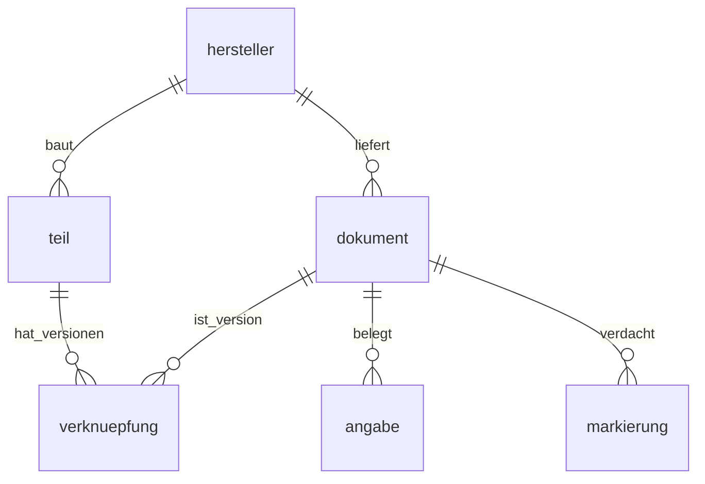

# Zertifikatsserver („Dokumentenarchiv“)

Eigener Dienst mit eigener PostgreSQL-Datenbank für die Dokumente des Maschinenbauers:
Zertifikate, Konformitätserklärungen, Anleitungen, Datenblätter, Zeichnungen und andere Dateien.
Im Case ist das Archiv ein eigenes System neben der Datenbank; hier steht dieser Dienst dafür. Er
übernimmt den Ordner `data/ex_dokumente/<Hersteller>/*.pdf` beim ersten Start als Altbestand
(Schritt „Server-Suche“ im Prozess, zwischen „In der Datenbank vorhanden?“ und der Websuche). Die Suche des Backends liest weiter den Ordner und dazu die PDFs,
die nur hier liegen.
**Für Anwender heißt der Dienst „Dokumentenarchiv“** (Tabelle „Begriffe“ unten); Code, Compose
und technische Doku bleiben bei `zertifikatsserver`.

Was er kann:

- **Ablage:** jede Datei liegt einmal in der eigenen Ablage, `aktuell/<Hersteller>/` oder
  `archiv/<Hersteller>/`. Gelöscht wird nie. Außer PDFs nimmt er Office-Dateien, Bilder,
  Zeichnungen und Archive an (siehe „Dateiformate“).
- **Quellennachweis:** je Dokument strukturiert, woher es kam (siehe „Quellennachweis“).
- **Versionen je Teil:** Ein Teil (Hersteller + Hersteller-Artikelnr.) hat je Dokumentart
  Versionen 1, 2, …; die aktuellen Versionen aller Arten stehen nebeneinander (Bescheinigung,
  Erklärung, Anleitung, Datenblatt, Zeichnung). Eine neue Version löst nur die alte derselben Art
  ab; die alte geht ins Archiv, ihr Link `/api/dokumente/<id>/datei` (früher `…/pdf`) bleibt.
- **Verdacht „veraltet“:** Regeln im Code melden mit Grund und Seite, welche Dokumente vermutlich
  veraltet sind. Ein Mensch bestätigt (dann ist eine neue Suche nötig) oder verwirft.
- **Bearbeiten:** Teile, Angaben der Dokumente und Versionen lassen sich von Hand korrigieren,
  jede Änderung steht mit Name, Zeit, alt und neu im Protokoll.
- **Texterkennung:** Scans ohne Textebene liest Tesseract im Hintergrund; solche Dokumente stehen
  als „per OCR gelesen“ da, ihre Werte können falsch sein.

Die Oberfläche dazu ist die Seite „Dokumentenarchiv“ der Oberfläche
(`web/seiten/zertifikatsserver.js`, über nginx unter `/zert/`, nur angemeldet); die Herkunft der
Funde zeigt `web/seiten/quellen.js` auf der Artikelseite.

## Start

```bash
docker compose up -d --build zertdb zertifikatsserver
docker compose logs zertifikatsserver     # Bericht des Imports
```

| Adresse | Was |
|---|---|
| http://localhost:5100/health | Server, nur auf diesem Rechner (keine eigene Anmeldung; von außen über die Oberfläche unter `/zert/`) |
| `localhost:5434` | PostgreSQL, nur auf diesem Rechner; Zugang aus `ZERT_DB*` in `.env.example` |

Beim Start legt der Server fehlende Tabellen an, trägt neue Spalten in eine vorhandene Datenbank
nach (`app/schema.py`, nur `ADD COLUMN` für Spalten, die leer sein dürfen; nie löschen oder
umbauen), trägt fehlende Normausgaben ein (siehe „Aktuelle Normausgaben“) und liest bei leerer
Datenbank den alten Ordner ein (`./data/ex_dokumente`, nur lesend unter `/altbestand`). Danach
startet im Hintergrund die Texterkennung (`flask --app wsgi ocr --dauerhaft`); Start und Import
warten nie auf sie. Von Hand: `docker compose exec
zertifikatsserver flask --app wsgi import-altbestand`; der Import ist wiederholbar, bekannte
Dateien (gleicher SHA-256) werden übersprungen.

## Aufbau

```
zertifikatsserver/
├── wsgi.py              Einstieg für gunicorn und flask
├── app/
│   ├── __init__.py      create_app, Befehle init-db, import-altbestand, regeln-pruefen,
│   │                    ocr, neu-auslesen
│   ├── config.py        Einstellungen aus Umgebungsvariablen
│   ├── modelle.py       Tabellen
│   ├── schema.py        neue Spalten in alte Datenbanken nachtragen
│   ├── auslesen.py      Angaben aus dem PDF lesen, je mit Seite
│   ├── ocr.py           Texterkennung für Scans im Hintergrund, neu auslesen
│   ├── normen.py        Tabelle der aktuellen Normausgaben: Vorgaben, Ändern, Bestätigen
│   ├── altbestand.py    Import des alten Ordners
│   ├── ablage.py        Dateien, Versionen, ausmustern und wiederherstellen
│   ├── dateiformate.py  erlaubte Dateiformate (Endung und Inhalt), Typ beim Ausliefern
│   ├── quellen.py       Quellennachweis: prüfen, setzen, korrigieren, alte Daten nachtragen
│   ├── begriffe.py      Wörter für Anwender je technischem Wert (GET /api/begriffe)
│   ├── bearbeiten.py    Korrekturen von Hand
│   ├── regeln.py        Regeln für den Verdacht „veraltet“, je Dokumentart
│   └── routen.py        HTTP-Endpunkte
└── tests/
```

## Datenmodell



| Tabelle | Speichert |
|---|---|
| `hersteller` | Name, Ordnername im Altbestand (`P+F` → `Pepperl+Fuchs`, siehe `HERSTELLER_NAMEN`) |
| `teil` | Hersteller + Hersteller-Artikelnr. (eindeutig, ohne Leer- und Satzzeichen verglichen), PRO.FILE-Nr. wenn bekannt |
| `dokument` | eine Datei: SHA-256 (eindeutig), Pfad in der Ablage, `dateiart` (Endung, leer = alte Zeile = PDF), Dokumentart, Seiten, lesbar ja/nein, Seiten ohne Textebene, Herkunft (`altbestand`, `upload`), Pfade im Altbestand, Ausstellungsdatum, gültig bis, ausgemustert von wem und warum; Texterkennung: `ocr_stand` (`offen`, `fertig`, `kein_text`, `fehler`), `ocr_seiten` (per OCR gelesen), `ocr_hinweis` (Ergebnis oder Grund in Worten); Quellennachweis `quelle_art`, `quelle_link`, `quelle_seite`, `quelle_abgerufen_am`, `quelle_von`, `quelle_dateiname`, `quelle_hinweis` |
| `angabe` | eine gelesene Angabe mit Seite und Textstelle: Dokumentart, Richtlinie, Normausgabe, Zertifikatsnummer, Ausstellungsdatum, gültig bis, Sprache; `sicher` und `quelle` (`pdf`, `ocr` oder `manuell`) |
| `verknuepfung` | Teil ↔ Dokument je Dokumentart mit `version`, gültig ab, abgelöst am, abgelöst durch, beendet von und warum, wer, Quelle (`altbestand`, `upload`, `manuell`, `atex_agent`), Beleg, `quellennachweis` (JSON, nur wenn der Weg dieser Version vom Dokument abweicht) |
| `markierung` | Verdacht „veraltet“: Regel oder Mensch, Grund, Seite, Stand `verdacht` → `bestaetigt` oder `verworfen`, wer entschieden hat und warum |
| `norm_ausgabe` | aktuelle Ausgabe je Norm, z. B. `60079-0` ab 2017; `quelle` (`vorgabe`, `konfiguration`, `manuell`), geändert und bestätigt von wem und wann |
| `aenderung` | Protokoll: Objekt, Feld, alt, neu, wer, wann, Grund; auch Normtabelle (`norm_ausgabe`, Feld = Norm), Läufe der Regeln (`regeln`) und OCR (`dokument`, Feld `ocr`) |
| `importlauf` | Zahlen und Hinweise jedes Imports |

Eine Version kann mehrere Dokumente haben, etwa dieselbe Bescheinigung auf Deutsch und Englisch.
Stand einer Version: `aktuell`, `abgeloest` (hat einen Nachfolger) oder `beendet` (von Hand,
ohne Nachfolger). Keine Migrationen, wie im Backend: Tabellen entstehen aus den Modellen; neue
Spalten müssen leer sein dürfen, dann trägt der Start sie in alte Datenbanken nach. Eine fehlende
Spalte, die nicht leer sein darf, meldet der Start im Log, anlegen muss sie ein Mensch.

## Import des Altbestands

- Jede Datei in einem Herstellerordner (PDF und die anderen erlaubten Formate; andere stehen mit
  Grund in den Hinweisen des Laufs, Dateien mit `.` am Anfang zählen nicht); Ordner mit `_` am
  Anfang (`_internet`, `_upload`) sind Zwischenspeicher des Backends und werden übersprungen.
- Quellennachweis: Art `altbestand` und der relative Pfad im Ordner, sonst nichts (Link und
  Abrufdatum sind nicht bekannt und werden nicht erfunden).
- Gleiche Datei unter mehreren Namen: einmal abgelegt, die anderen Pfade stehen in `altpfade`.
- Scans ohne Textebene: zunächst „nicht lesbar“, Dokumentart `unbekannt`, keine Angaben, OCR-Stand
  `offen`. Die Texterkennung liest sie danach im Hintergrund (siehe „Texterkennung“).
- **Teile:** nur aus dem Dateinamen. Ein Wort, das wie eine Typbezeichnung aussieht (mehr Groß-
  als Kleinbuchstaben, Ziffern, keine Zertifikatsnummer, kein Prüfstellenname), wird ein Teil;
  steht es auch im Text, ist die Seite der Beleg, sonst „nur Dateiname“. Klein geschriebene Wörter
  (`festo_dsm_konf.pdf`) zählen nur, wenn der Text sie als Typ schreibt (`DSM`).
- Mehrere Dokumente gleicher Art zu einem Teil kommen in dieselbe Version 1, mit Hinweis: welches
  neuer ist, entscheidet der Import nicht.

Stand mit den 87 PDFs des Case (nicht in diesem Repository):

| | Anzahl |
|---|---|
| PDF-Dateien | 87 |
| davon Dubletten (gleicher SHA-256) | 5 |
| Dokumente abgelegt | 82 |
| nicht lesbar (Scan ohne Textebene) | 8, dazu 3 teilweise ohne Text |
| mit Teil verknüpft | 50 Dokumente, 38 Teile, 54 Verknüpfungen |
| ohne Teil | 32 |
| Versionen mit mehreren Dokumenten gleicher Art | 9 |

Die Zuordnung ist ein Vorschlag aus Dateinamen. Typbezeichnungen wie `152-1AA0` oder `972-0AC80`
sind Bruchstücke von Bestellnummern; ein Mensch korrigiert auf der Seite „Dokumentenarchiv“.

## Regeln für „veraltet“

Die Regeln laufen nur für PDFs (aus anderen Dateien liest das Archiv nichts) und je Regel nur für
die Dokumentarten in `regeln.GILT_FUER` („Gilt für“). `sonstiges` und `unbekannt` sind immer dabei:
das kann eine Bescheinigung oder Erklärung sein, die die Auslesung nicht erkannt hat.

| Kennung | Stufe | Gilt für | Wann | Grundlage |
|---|---|---|---|---|
| `richtlinie_94_9` | veraltet | EU/UK-Konformitätserklärung, sonstiges, unbekannt | nennt 94/9/EG, aber nicht 2014/34/EU. Eine Baumusterprüfbescheinigung nach 94/9/EG bekommt nur einen neutralen Hinweis (`hinweise`), keinen Verdacht | Vorschrift: 94/9/EG ist seit 20.04.2016 aufgehoben (Art. 43 der 2014/34/EU), Bescheinigungen nach 94/9/EG gelten weiter (Art. 41) |
| `norm_ausgabe` | veraltet | EU/UK-Baumusterprüfbescheinigung, EU/UK-Konformitätserklärung, sonstiges, unbekannt | nennt eine Norm aus `norm_ausgabe` nur in älteren Ausgaben (mehrere Normen: eine Markierung, alle im Grund) | Logik gegen eine Tabelle, die Menschen pflegen und bestätigen |
| `alter` | veraltet | wie `norm_ausgabe` | Ausstellungsdatum älter als `VERALTET_NACH_JAHREN` (Standard 10) | Faustregel mit einstellbarer Grenze, keine Vorschrift |
| `gueltig_bis` | veraltet | wie `norm_ausgabe`, dazu Bedienungsanleitung, Datenblatt, Zeichnung | „gültig bis“ / „valid until“ ist vorbei | Logik: Angabe des Dokuments selbst |
| `kein_datum` | unklar | wie `norm_ausgabe` | kein Ausstellungsdatum gefunden, z. B. Scan | Logik: Alter nicht beurteilbar |

Warum: Eine Anleitung oder ein Datenblatt nennt Normen und Richtlinien als Hintergrund und trägt
oft kein Ausstellungsdatum; ein Verdacht daraus wäre Rauschen. Wer dagegen selbst ein Ende
nennt („gültig bis“), ist danach alt, gleich welcher Art. Gemessen an den 82 Dokumenten des Case
(ohne Texterkennung): mit den Dokumentarten fallen 5 Verdachte weg, alle an den 4
Bedienungsanleitungen (4-mal kein Datum, einmal ältere Normausgabe); sonst ändert sich nichts.
Ändert sich die Art eines Dokuments, fällt ein offener Verdacht der Regel, die nicht mehr gilt,
beim nächsten Lauf weg; entschiedene bleiben.

Keine Regel kennt Hersteller, Dateinamen oder einzelne Dokumente des Altbestands; nur die
Vorgaben der Normtabelle sind nach den Normen gewählt, die im Altbestand vorkommen.

Jede Markierung trägt Grund, Seite und Textstelle; stammt die Angabe von einer per OCR gelesenen
Seite, sagt der Grund das. Das Ausstellungsdatum ist das späteste Datum
mit Stichwort davor („Datum“, „Date of issue“); Daten zitierter Richtlinien („2014/34/EU … vom
26. Februar 2014“) zählen nicht. Ohne Stichwort gilt das späteste Datum und steht als unsicher da.

Die Regeln laufen nach dem Import, nach jedem Hochladen, nach jeder Korrektur eines Dokuments,
nach einer Änderung der Normtabelle und auf Knopfdruck. Ein Verdacht, dessen Regel nicht mehr
greift, fällt weg; bestätigte und verworfene Markierungen bleiben.

Stand mit den 82 Dokumenten des Case (Probe auf einer Kopie: alte Datenbank, dann neuer Server
mit Vorgaben, Texterkennung und `neu-auslesen`), offene und entschiedene Markierungen:

| Regel | vorher | nur Vorgaben | nach OCR und neuer 94/9-Regel |
|---|---|---|---|
| 94/9/EG | 8 | 8 | 8 (dazu 7 Bescheinigungen mit neutralem Hinweis) |
| ältere Normausgabe | 11 | 11 | 14 |
| älter als 10 Jahre | 8 | 8 | 13 |
| abgelaufen | 0 | 0 | 0 |
| kein Datum (unklar) | 24 | 24 | 18 |

Die neuen Vorgaben allein ändern nichts: jedes Dokument mit alter Ausgabe von 60079-7, -11 oder
-31 nennt auch eine alte Ausgabe von 60079-0. Die Zuwächse kommen aus den 8 Scans, die jetzt
lesbar sind.

### Aktuelle Normausgaben

**Vergleich:** Eine Nennung zählt mit dem Jahr direkt hinter der Nummer, auch über einen
Zeilenumbruch hinweg; Änderungen („EN 60079-0:2012+A11:2013“ zählt als 2012) und Nennungen ohne
Jahr („EN 60079-14“) zählen nicht. Die Regel schlägt an, wenn alle datierten Nennungen einer Norm
älter sind als das Jahr in der Tabelle; dort steht deshalb das Jahr der IEC-Ausgabe (IEC
60079-0:2017 = EN IEC 60079-0:2018 → 2017), sonst gälte die gleichwertige IEC-Nennung als alt.

**Vorgaben:** Beim Start trägt der Server für jede Norm ohne Zeile eine Vorgabe ein, zuerst aus
`AKTUELLE_NORMEN`, dann aus `app/normen.py`. Vorhandene Zeilen überschreibt er nie, auch nicht in
einer alten Datenbank; kamen Zeilen dazu, rechnet `init-db` die Regeln neu (gefahrlos: neue
Befunde werden Verdacht, entschiedene Markierungen bleiben). Jede Vorgabe ist „zu bestätigen“
(Oberfläche und `GET /api/normen`: `zu_bestaetigen`, `pruefhinweis`), bis ein benannter Mensch sie
bestätigt (`POST /api/normen/bestaetigen`) oder ändert; dann stehen `bestaetigt_von` und
`bestaetigt_am` daneben.

Die Vorgaben sind die neueste Ausgabe, die das Team ohne Recherche sicher kennt und für
harmonisiert hält: **Vorgabe des Teams, bitte gegen die aktuelle Liste harmonisierter Normen zu
2014/34/EU prüfen.** Gibt es eine neuere Ausgabe, schlägt die Regel zu selten an, nicht zu oft.

| Norm | Dokumente mit datierter Nennung | Vorgabe (IEC-Jahr) |
|---|---|---|
| 60079-0 | 45 | 2017 |
| 60079-11 | 22 | 2011 (Ausgabe 2023 erschienen, 7 Dokumente nennen 2023/2024; Harmonisierung prüfen) |
| 60079-7 | 20 | 2015 |
| 60079-31 | 18 | 2013 |
| 60079-1 | 6 | 2014 |
| 60079-15 | 6 | 2010 (Ausgabe 2017 nach Wissen des Teams erschienen) |
| 60079-26 | 2 | 2014 |
| 60079-28 | 2 | 2015 |
| 60079-18 | 1 | 2014 |

Gezählt in den 74 Dokumenten mit Textebene. Ohne Vorgabe, weil nur ohne Jahr genannt:
60079-14 (5 Dokumente), 60079-25 (3), 60079-10 (1), 60079-17 (1). Nicht gelesen (andere Reihen):
EN 60529 (17), EN IEC 63000 (13), EN ISO 80079-36/-37 (je 7), EN 13463-1/-5 (je 5, zurückgezogen),
EN 50014/50020/50281-1-1/50284 (je 2, zurückgezogen) und weitere.

## Texterkennung

Entscheidung: eigenes Tesseract im Image (wie im Backend: Deutsch, Englisch, Französisch, 300 dpi),
kein Lesen des OCR-Zwischenspeichers des Backends. Der Server bleibt damit für sich lauffähig, liest
auch Scans, die nur hier hochgeladen werden (Antworten der Hersteller, vom Backend weitergereichte
Funde), und hängt nicht am Volume und Dateiformat eines anderen Dienstes. Preis: das Image wird
etwa 150 MB größer, und die Scans werden ein zweites Mal gelesen (einmalig; die 8 Scans und 3 teilweise gescannten Dokumente des
Altbestands, 78 Seiten, brauchten in der Probe gut 20 Minuten, 12 bis 30 Sekunden je Seite).

- Import und Hochladen warten nie: ein Dokument mit Seiten ohne Textebene bekommt den Stand
  `offen`. Der Hintergrundlauf (`flask --app wsgi ocr --dauerhaft`, im Container mit `nice`) liest
  offene Dokumente, legt den Text je Datei in `OCR_CACHE` ab und schickt das Dokument durch dieselbe
  Auslesung und dieselben Regeln. Liegt der Text schon im Zwischenspeicher, gilt er beim Anlegen.
- Angaben von OCR-Seiten haben `quelle` „ocr“ und einen Hinweis; das Dokument zeigt „per OCR
  gelesen, Werte können falsch sein“. Von Hand gesetzte Angaben bleiben.
- Findet die OCR nichts (`kein_text`) oder scheitert sie (`fehler`), bleibt das Dokument „nicht
  lesbar“; der Grund steht in `ocr_hinweis` und im Grund der Regel `kein_datum`. Mit `OCR=0` oder
  ohne Tesseract bleibt der Stand `offen`, mit Grund.
- Jede Übernahme steht im Protokoll (`dokument`, Feld `ocr`, von „Texterkennung“).

## API

JSON überall, Fehler als `{"error": "…"}` in Sätzen für Anwender (auch 404, 405, 413). Wer etwas
ändert, kommt aus dem Kopf `X-Anwender`, den nginx nach der Anmeldung setzt; ohne Kopf (Backend,
Tests) aus `von`. Ohne Namen keine Änderung. Neben technischen Werten stehen Texte für Anwender
(`doc_type_text`, `markierungsstand_text`, `ablage_text`, `stand_text`, `status_text`,
`stufe_text`, `quelle_text`, `ocr_stand_text`, im Protokoll `objekt_text`, `feld_text`, `alt_text`,
`neu_text`; Systemnamen in `von` wie „Import Altbestand“ in Worten).

| Methode und Pfad | Zweck |
|---|---|
| `GET /health` | läuft der Server |
| `GET /api/teile?hersteller=…&artikelnr=…&profile_no=…` | Teile suchen: erst genau, sonst teilweise (`treffer`), je Teil `aktuell` und `historie` mit `pdf_url` |
| `POST /api/teile` | Teil anlegen: `hersteller`, `artikelnr`, `von`, optional `profile_no`, `bezeichnung` |
| `GET /api/teile/<id>` | Teil mit allen Versionen und Änderungsprotokoll |
| `PATCH /api/teile/<id>` (auch `PUT`) | Hersteller, Artikelnr., PRO.FILE-Nr., Bezeichnung ändern |
| `POST /api/teile/<id>/dokumente` | neue Version hochladen (multipart: `datei` als PDF oder erlaubtes Format, `von`, `doc_type` (bei PDF sonst erkannt, sonst Pflicht), `hinweis`, `quelle` = Weg der Version `upload` oder `atex_agent`, Quellennachweis `quelle_art`, `quelle_link`, `quelle_seite`, `quelle_abgerufen_am`, `quelle_dateiname`, `quelle_hinweis`). Nicht erlaubte Datei: `400` mit einem Satz für Anwender |
| `POST /api/teile/<id>/verknuepfungen` | vorhandenes Dokument als neue Version: `dokument_id`, `von`, optional `doc_type`, `quellennachweis: {art, link, …}` |
| `POST /api/verknuepfungen/<id>/beenden` | Version beenden, ohne Nachfolger: `von`, `grund` |
| `POST /api/verknuepfungen/<id>/umhaengen` | Dokument einem anderen Teil zuordnen: `teil_id`, `von`, `grund` |
| `POST /api/verknuepfungen/<id>/wiederherstellen` | beendete oder abgelöste Version wieder aktuell |
| `POST /api/dokumente` | Datei ohne Teil ablegen (multipart: `datei`, `von`, `hersteller`, optional `doc_type`, `hinweis`, Quellennachweis wie beim Hochladen); gleiche Datei schon da: `200` mit `bekannt: true` |
| `GET /api/dokumente?hersteller=&markierung=&regel=&ablage=&doc_type=&verknuepft=&lesbar=&ausgemustert=&auslesbar=&dateiart=&familie=&quelle_art=&sha256=` | Dokumente filtern; je Dokument `dateiart`, `dateiart_text`, `familie`, `mimetype`, `im_browser`, `auslesbar`, `auslesbar_grund`, `datei_url`, `quelle_art` und die Texte `…_text` |
| `GET /api/dokumente/<id>` | Dokument mit Angaben, Markierungen, Teilen samt Versionen, Protokoll, `quellennachweis`; wie in der Liste `per_ocr`, `ocr_seiten`, `ocr_stand`, `ocr_hinweis` |
| `PATCH /api/dokumente/<id>` | Angaben korrigieren: `doc_type`, `ausstellungsdatum`, `gueltig_bis`, `zertifikatsnummern`, `sprachen`, `richtlinien`, `normen`, optional `seiten: {Feld: Seite}` (nur PDF); Quellennachweis `quelle_art`, `quelle_link`, `quelle_seite`, `quelle_abgerufen_am`, `quelle_von`, `quelle_dateiname`, `quelle_hinweis`; rechnet die Regeln neu |
| `GET /api/dokumente/<id>/datei` | die Datei mit ihrem Typ, auch aus dem Archiv; PDF und PNG/JPG/GIF im Browser (`?download=1` zum Speichern), alles andere nur als Anhang; immer `X-Content-Type-Options: nosniff`. `…/pdf` ist derselbe Link unter altem Namen |
| `GET /api/dateien/<sha256>` | dieselbe Datei über ihren SHA-256 |
| `GET /api/begriffe` | Wörter für Anwender (Tabelle „Begriffe“), Regeln mit ihren Dokumentarten, erlaubte Dateiformate |
| `POST /api/dokumente/<id>/ausmustern` | „Löschen“: Datei ins Archiv, aktuelle Versionen enden: `von`, `grund` |
| `POST /api/dokumente/<id>/wiederherstellen` | Ausmustern rückgängig |
| `POST /api/markierungen` | Auswahl von Hand als veraltet markieren: `dokument_ids`, `von`, `grund`, optional `bestaetigen: true` |
| `POST /api/markierungen/bestaetigen` | Verdacht bestätigen: `dokument_ids` oder `markierung_ids`, `von` |
| `POST /api/markierungen/verwerfen` | Verdacht verwerfen: wie oben, dazu `grund` |
| `GET /api/neue-suche` | bestätigte, noch aktuelle Dokumente mit Gründen und Teilen |
| `POST /api/regeln/pruefen` | Regeln neu rechnen, optional `dokument_ids`; mit `von` im Protokoll (`objekt=regeln`, ohne Namen „nicht angegeben“) |
| `GET /api/regeln`, `GET /api/normen` | Regeln, Grenze in Jahren, aktuelle Normausgaben; je Norm `quelle`, `zu_bestaetigen`, `pruefhinweis`, `bestaetigt_von`, `bestaetigt_am` |
| `PUT /api/normen` | Tabelle auf die Liste bringen: `normen: [{norm, jahr, hinweis?}]`, `von`. Name und Zeit nur an Zeilen, die sich ändern (gelten dann als bestätigt); „EN IEC 60079-0“ wird „60079-0“; doppelte Normen oder Jahre außerhalb 1900–2100: 400. Antwort mit `geaendert` |
| `POST /api/normen/bestaetigen` | Vorgaben unverändert bestätigen: `normen: ["60079-0", …]`, `von` |
| `GET /api/aenderungen?objekt=&objekt_id=` | Änderungsprotokoll |
| `GET /api/hersteller`, `GET /api/importe` | Hersteller mit Anzahl Dokumente, Berichte der Importe |

## Anschluss an das Backend

Gebaut (`backend/app/services/zertifikatsserver.py`, siehe `docs/api.md`, „Zertifikatsserver in
der Suche“):

1. **Markierungen in der Suche:** Die Ordnersuche des Backends fragt je Position
   `GET /api/dokumente?sha256=…` nach den Markierungen ihrer Funde. Bestätigt veraltete Dateien
   werden nicht vorgeschlagen, ein Verdacht steht in der Vorprüfung.
2. **Ersatz für veraltete:** `GET /api/neue-suche` liefert die bestätigten Dokumente; das
   Backend findet darüber die betroffenen Positionen eines Vorgangs und sucht sie auf Knopfdruck
   neu (Reiter „Ersatz wird gesucht“ der Seite).
3. **Freigaben als neue Version:** Gibt ein Mensch im Backend ein Dokument frei, das der Server
   nicht kennt, lädt das Backend es als neue Version des Teils hoch, mit Quellennachweis in den
   Feldern `quelle_*` (Art, Download-Link, Abrufzeit, ursprünglicher Dateiname, wer) und
   `quelle=atex_agent`. Scheitert das, gilt die Freigabe trotzdem; nachgeholt wird mit
   `flask --app wsgi zert-abgleich` im Backend oder bei der nächsten Freigabe.
4. **Was nur der Server hat, findet die Suche:** Das Backend holt die aktuellen PDFs des
   Herstellers, die nicht unter `ATEX_DOCS` liegen, in einen Zwischenspeicher
   (`_upload/zertifikatsserver/<Hersteller>/`) und durchsucht ihn wie einen Herstellerordner. Andere
   Dateiarten holt es nicht (`dateiart=pdf`).
5. **Herkunft auf der Prüfseite und in der Kundenliste:** Je Fund zeigt die Artikelseite die
   Herkunft und, ob die Datei schon im Archiv liegt (`GET /api/dokumente?sha256=…`, Link
   `/api/dateien/<sha256>`). Die Spalte „DL-Link“ der Kundenliste nimmt den Download-Link des
   Herstellers, sonst `<OEFFENTLICHE_ADRESSE>/zert/api/dokumente/<id>/datei`.

## Dateiformate

`dateiformate.py`: erlaubt ist eine Datei nur, wenn ihre Endung in der Liste steht UND die ersten
Bytes dazu passen (bei Office-Formaten das Inhaltsverzeichnis des ZIP-Containers, ohne zu
entpacken); höchstens `DATEI_MAX_MB` (Standard 50, nginx lässt 64 MB durch). Alles andere lehnt
der Server mit einem Satz ab (`400`), auch HTML, SVG und Programme.

| Familie | Endungen | im Browser |
|---|---|---|
| PDF | pdf | ja |
| Office | docx, xlsx, pptx, doc, xls, ppt, odt, ods, rtf | nein, Download |
| Text | txt, csv | nein, Download |
| Bild | png, jpg, jpeg, gif | ja |
| Bild | tif, tiff | nein, Download |
| Zeichnung | dwg, dxf, stp, step | nein, Download |
| Archiv | zip, 7z | nein, Download, nie entpackt |

Nur aus PDFs liest der Server Angaben, nur dort laufen Prüfregeln und Texterkennung. Andere
Dateien liegen mit Dokumentart „unbekannt“ da, bis jemand sie setzt (beim Hochladen zu einem Teil
ist sie Pflicht); die API sagt das je Dokument (`auslesbar: false`, `auslesbar_grund`). Versionen,
Ausmustern, Wiederherstellen, Protokoll und Filter gelten für alle Dateiarten gleich.

## Quellennachweis

Je Dokument (`quellen.py`, Spalten `quelle_*`), in der API als Block `quellennachweis`:

| Feld | Inhalt |
|---|---|
| `art` | `altbestand` (alter Ordner), `internet` (Websuche), `hersteller` (Antwort des Herstellers), `hochgeladen` (von Hand), `atex_agent` (Freigabe im ATEX-Agent, Weg sonst nicht bekannt) |
| `link` | ursprünglicher Download-Link, nur `http(s)` |
| `seite_gefunden_auf` | Webseite, auf der der Link stand; leer = nicht bekannt (die Websuche hält sie nicht fest) |
| `abgerufen_am` | wann die Datei geholt wurde oder einging |
| `uebernommen_von`, `uebernommen_am` | wer sie ins Archiv brachte, wann |
| `dateiname` | ursprünglicher Dateiname; beim Bestand der relative Pfad im Ordner |
| `hinweis` | freie Anmerkung |
| `sha256`, `archiv_link` | Prüfsumme und stabiler Link `/api/dokumente/<id>/datei` |
| `text`, `art_text` | Satz für Anwender: was bekannt ist und was nicht |

Kommt dieselbe Datei später auf anderem Weg noch einmal (gleicher SHA-256), bleibt der Nachweis
am Dokument (der erste Weg), die neue Version trägt ihren eigenen (`verknuepfung.quellennachweis`).
Ein Mensch kann jedes Feld korrigieren (`PATCH /api/dokumente/<id>`), jede Änderung steht im
Protokoll. Alte Datenbanken: Der Start trägt den Nachweis aus dem schon Gespeicherten nach
(Bestand mit Pfad; Freigaben aus dem ATEX-Agent aus dem Satz an der Version, mit Link, wenn er
dort stand; sonst „hochgeladen“), mit Protokolleintrag von „Dokumentenarchiv“. Ein älteres Backend,
das nur den Satz schickt, bekommt denselben Nachweis aus dem Satz.

## Begriffe

Was Anwender lesen (`begriffe.py`, `GET /api/begriffe`); technische Werte bleiben in der API.

| Technisch | Für Anwender |
|---|---|
| Zertifikatsserver (Dienst) | Dokumentenarchiv |
| Markierungsstand `ohne` | Unauffällig |
| `verdacht` | Möglicherweise veraltet |
| `bestaetigt` („neue Suche nötig“) | Veraltet, Ersatz wird gesucht |
| `verworfen` | Geprüft, gilt weiter |
| Stufe `veraltet` / `unklar` | Spricht für veraltet / Lässt sich nicht beurteilen |
| ausgemustert | Im Archiv abgelegt (nicht mehr in Gebrauch); Aktion „Ins Archiv legen“, zurück „Wieder in Gebrauch nehmen“ |
| Ablage `aktuell` / `archiv` | In Gebrauch / Im Archiv |
| Version `aktuell` / `abgeloest` / `beendet` | Aktuelle Version / Durch neuere Version ersetzt / Beendet, ohne Nachfolger |
| Altbestand | Übernommener Bestand |
| Import | Bestand einlesen |
| Regeln | Prüfregeln |
| Reiter „Neue Suche nötig“ | Ersatz wird gesucht |
| Dokumentart `unbekannt` | Dokumentart noch offen |
| `sonstiges` | Sonstiges Dokument |
| Quelle `altbestand`, `internet`, `hersteller`, `hochgeladen`, `atex_agent` | Übernommener Bestand, Im Internet gefunden, Vom Hersteller geschickt, Von Hand hochgeladen, Bei einer Freigabe im ATEX-Agent übernommen |
| Version-Quelle `altbestand`, `upload`, `manuell`, `atex_agent` | Beim Einlesen des Bestands zugeordnet, Hochgeladen, Von Hand zugeordnet, Bei einer Freigabe im ATEX-Agent übernommen |
| OCR-Stand `offen`, `fertig`, `kein_text`, `fehler` | Texterkennung steht noch aus, Text aus der Texterkennung, Texterkennung fand keinen Text, Texterkennung gescheitert |
| Protokoll-Felder `doc_type`, `profile_no`, `artikelnr`, `ocr`, `auslesung`, `pruefen`, `ausgemustert`, `stand`, `quelle_*` | Dokumentart, PRO.FILE-Nummer, Hersteller-Artikelnummer, Texterkennung, Angaben neu gelesen, Prüfregeln angewendet, Archiv, Stand der Version, Herkunft und ihre Felder |
| `von` „Import Altbestand“, „Regel“, „Auslesung neu“, „Konfiguration“ | Bestand einlesen, Prüfregel, Angaben neu gelesen, Grundeinstellung |
| Markierung ohne Regel | Von Hand als veraltet gemeldet |

## Einstellungen

| Variable | Standard | Bedeutung |
|---|---|---|
| `DATABASE_URL` | `sqlite:///zertifikate.db` | im Compose die eigene PostgreSQL `zertdb` |
| `ABLAGE` | `/ablage` | eigene Ablage, im Compose das Volume `zert-ablage` |
| `ALTBESTAND` | `/altbestand` | alter Ordner, nur lesend |
| `HERSTELLER_NAMEN` | `P+F=Pepperl+Fuchs` | Ordnername = Herstellername, mit Komma |
| `VERALTET_NACH_JAHREN` | `10` | Grenze der Regel `alter` |
| `AKTUELLE_NORMEN` | leer | „Norm:Jahr“ mit Komma, Startwert für Normen ohne Zeile, vor den Vorgaben |
| `OCR` | `1` | Texterkennung für Scans, `0` = aus (Scans warten dann mit Grund) |
| `OCR_SPRACHEN` | `deu+eng+fra` | Sprachen für Tesseract |
| `OCR_CACHE` | leer = `<ABLAGE>/.ocr` | Text je Datei (SHA-256), überlebt einen neuen Import |
| `OCR_INTERVALL` | `60` | Sekunden, nach denen der Hintergrundlauf nach neuen Scans sieht |
| `DATEI_MAX_MB` | `50` | größte Datei beim Hochladen (nginx lässt bis 64 MB durch) |

## Tests

```bash
docker build -t atex-zertifikatsserver zertifikatsserver
docker run --rm -v "$PWD/zertifikatsserver:/app" atex-zertifikatsserver pytest
```

Mit dem Image aus `docker compose build` geht es ohne eigenen Build (aus dem Hauptordner des
Repositorys; der Name des Images hängt vom Ordnernamen ab):
`docker run --rm -e PYTHONDONTWRITEBYTECODE=1 -v "$PWD/zertifikatsserver:/app" <projekt>-zertifikatsserver python -m pytest -q -p no:cacheprovider`.

Die Tests laufen gegen SQLite im Arbeitsspeicher und bauen ihre PDFs selbst (PyMuPDF). Die OCR
täuschen sie vor; nur `test_echte_texterkennung` ruft Tesseract und wird ohne ihn übersprungen.
`test_dateien_quellen.py` prüft andere Dateiformate, abgelehnte Dateien, Download-Köpfe,
Quellennachweis, Regeln je Dokumentart und die Texte für Anwender.

## Grenzen

- OCR-Werte können falsch sein; sie stehen mit quelle „ocr“ da, ein Mensch prüft sie im PDF.
  Beispiel aus der Probe: in der INERIS-Bescheinigung des Kameragehäuses las die Auslesung den
  23.03.1994 (Datum der Richtlinie 94/9/EG) als Ausstellungsdatum, weil der OCR-Text das „vom“
  davor nicht sauber enthielt. Ein gescheiterter Lauf (`fehler`) wird nicht von selbst
  wiederholt.
- Die Auslesung läuft nur beim Anlegen und nach OCR. Nach einer verbesserten Regel im Code liest
  `flask --app wsgi neu-auslesen` alle Dokumente neu (von Hand gesetzte Angaben bleiben).
- Erkennt die OCR die Dokumentart eines Scans, bekommt seine Version aus dem Import diese Art nur,
  wenn das Teil noch keine andere Version dieser Art hat; sonst steht ein Hinweis an der Version.
- Nur Normen der Reihe 60079 werden gelesen; EN ISO 80079-36/-37, EN 13463 (zurückgezogen),
  EN 50014 ff. (zurückgezogen) stehen in Dokumenten, zählen aber nicht.
- Ändert man die Dokumentart eines Dokuments, behalten seine Versionen ihre bisherige Art; zum
  Umsortieren die Version beenden und das Dokument unter der neuen Art neu zuordnen.
- Teile entstehen beim Import nur aus Dateinamen, nicht aus dem PDF-Text.
- Filter der Dokumentliste rechnen in Python, nicht in SQL; für einige Tausend Dokumente reicht das.
- Die Webseite, auf der die Websuche einen Download-Link fand, kennt der Nachweis nicht: die
  Websuche (`backend/app/services/internet.py`) hält sie nicht fest. Ein Mensch kann sie von Hand
  eintragen.
- Aus anderen Dateien als PDF liest der Server nichts, auch nicht aus Word-Dateien mit Text;
  Prüfregeln laufen für sie nicht. Archive werden nie geöffnet, ihr Inhalt ist nicht geprüft.
- Die Links ins Archiv (auch in der Kundenliste) öffnen sich nur für angemeldete Benutzer.
- Dateien vor dem Quellennachweis: der Start trägt nur nach, was schon gespeichert war; Abrufzeit
  und Webseite bleiben dort leer.
